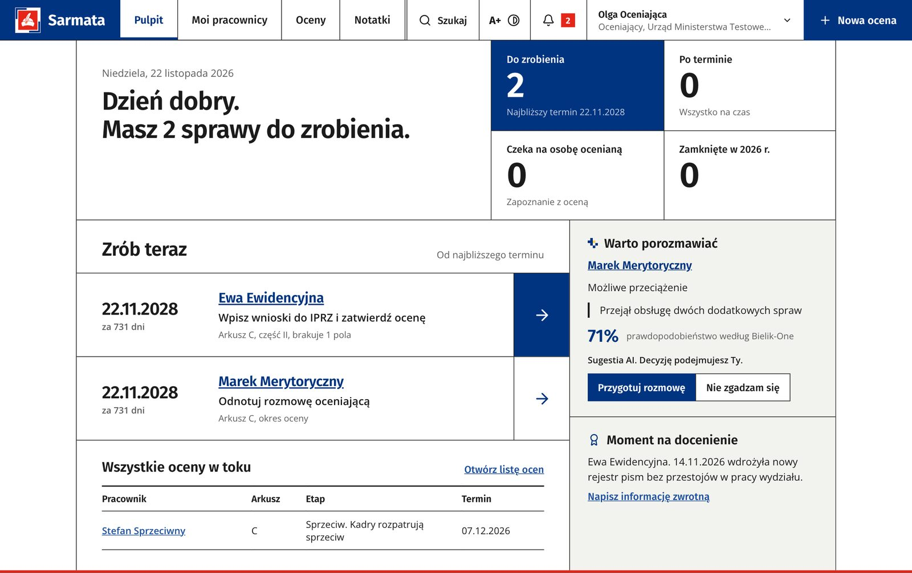
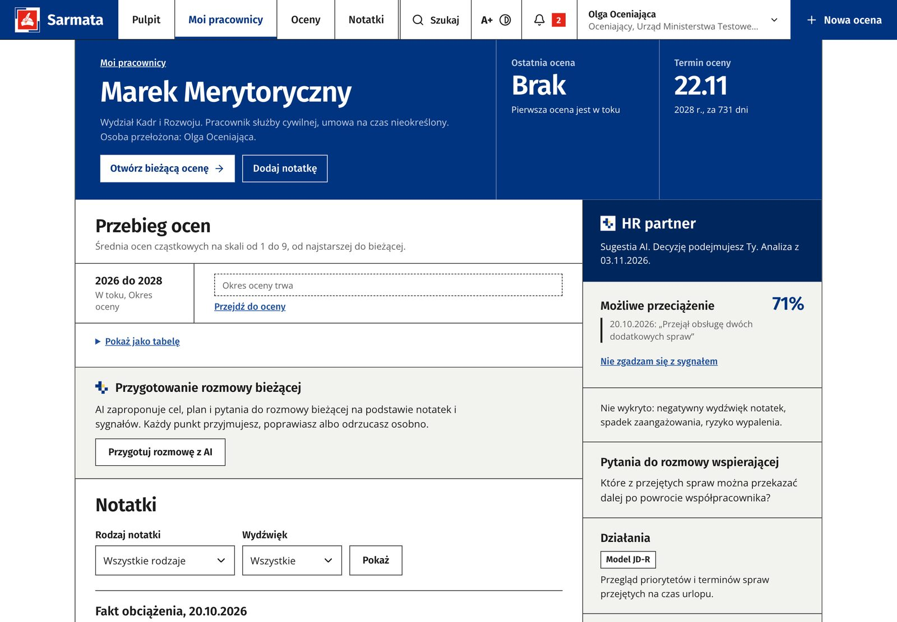
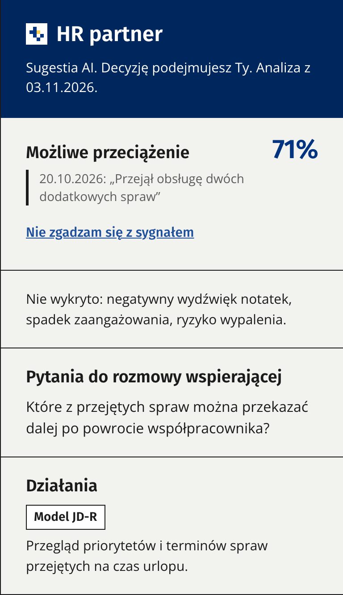
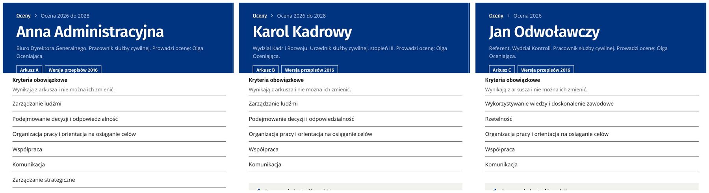
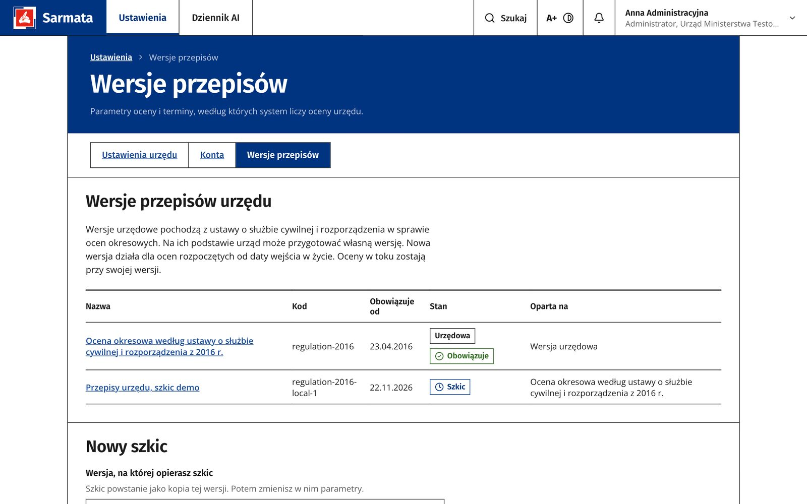
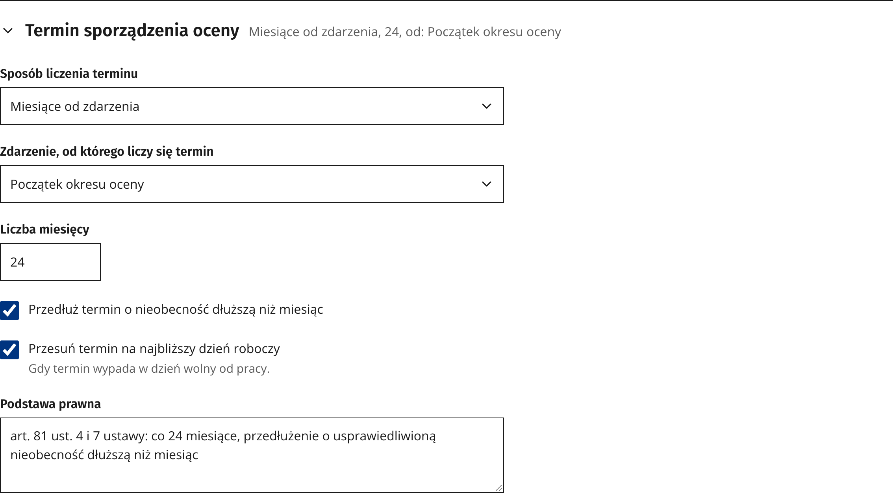

# Sarmata

**S**ystem **A**utomatycznej **R**ejestracji i **M**onitorowania **A**wansów, **T**erminów i **A**naliz

Sarmata prowadzi ocenę okresową w służbie cywilnej od wyboru arkusza do zamknięcia oceny: kryteria, rozmowy, notatki z okresu oceny, część II, sprzeciw, wniosek o stopień i PDF według wzoru z rozporządzenia. Terminy liczy z ustawy, a przepisy trzyma jako wersjonowane dane, więc nowelizacja to nowa wersja przepisów, a nie przebudowa systemu. Lokalny model Bielik podpowiada treść oceny, przygotowuje rozmowy i jako partner HR wskazuje przeciążenie oraz momenty na docenienie. Dane nie opuszczają serwera urzędu, a decyzje podejmuje przełożony.

## Dokumentacja

- [Instalacja w urzędzie](docs/instalacja.md): kreator, trzy profile (light, standard, server), aktualizacje i kopie zapasowe.
- [Uruchomienie i konfiguracja dla deweloperów](docs/dla-deweloperow.md): uruchomienie od czystej maszyny, `pnpm build` i `pnpm start`, skrypty, zmienne środowiskowe, konta demo.
- Dokumentacja techniczna: [architektura](docs/architektura.md), [decyzje architektoniczne (ADR)](docs/adr/), [funkcjonalności i reguły](docs/funkcjonalnosci.md), [wymagania i kontekst prawny](docs/wymagania-i-kontekst.md), [słownik pojęć](GLOSSARY.md).

## Funkcje

### Pulpit z terminami z przepisów

Oceniający widzi sprawy na dziś, terminy wyliczone z ustawy i podpowiedzi partnera HR. Aplikacja przypomina o terminach i nie pozwoli zatwierdzić niepełnego arkusza.

### Szkic oceny od lokalnego Bielika

Przełożony może skorzystać ze szkicu oceny, który Bielik przygotuje na podstawie jego notatek. Każda propozycja poziomu wskazuje notatkę źródłową, a oceniający ją przyjmuje albo odrzuca. Wynik końcowy liczy kalkulator według progów z rozporządzenia, a nie model.

### Partner HR

Partner HR wychwytuje w notatkach oznaki przeciążenia i pokazuje fragment, na którym opiera sygnał. Podpowiada pytania do rozmowy wspierającej i działania, a przełożony może nie zgodzić się z sygnałem. To sugestia, a nie diagnoza, i nie trafia do arkusza.

### Arkusze A, B i C w PDF według wzoru

Aplikacja proponuje arkusz według stanowiska i prowadzi przez wszystkie jego pola. Gotową ocenę można pobrać jako PDF albo DOCX w układzie wzoru z rozporządzenia, a teczkę sprawy i paczkę do EZD jako pliki ZIP.

### Przepisy jako wersjonowane dane

Każdy termin, próg i kryterium ma podstawę prawną i należy do wersji przepisów. Administrator zmienia parametr w wersji urzędu i publikuje ją z datą wejścia w życie, a aktualizacja aplikacji przynosi nowe wersje po zmianie ustawy. Ocena zostaje przy wersji z dnia rozpoczęcia.

### Kreator instalacji

Kreator prowadzi krok po kroku przez instalację w jednym z trzech profili (light, standard, server) na Windows, macOS albo Linux, bez płatnych licencji. Sam dobiera model Bielik do sprzętu, a na mocniejszym sprzęcie uruchamia obok niego Bielik-One do sygnałów partnera HR.

