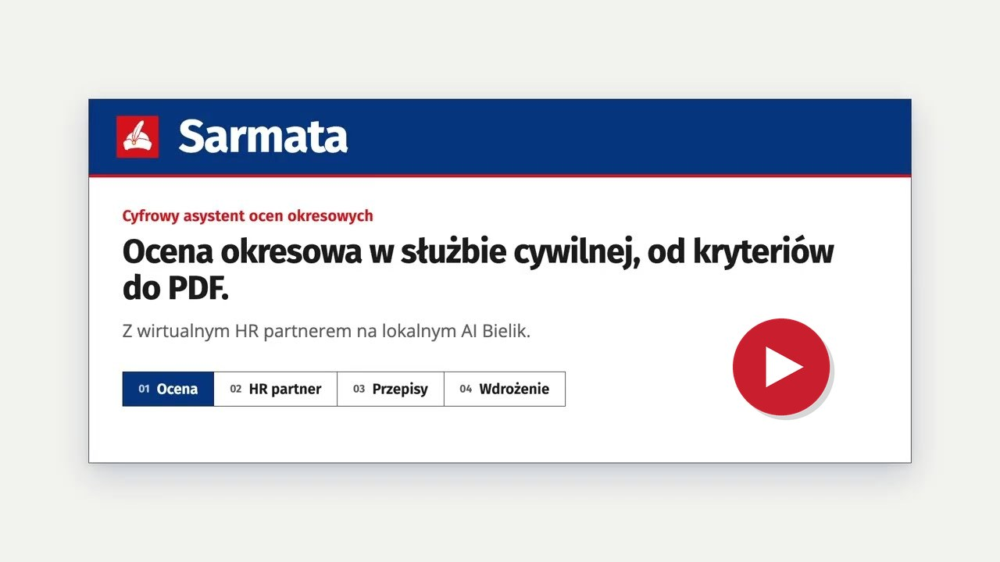
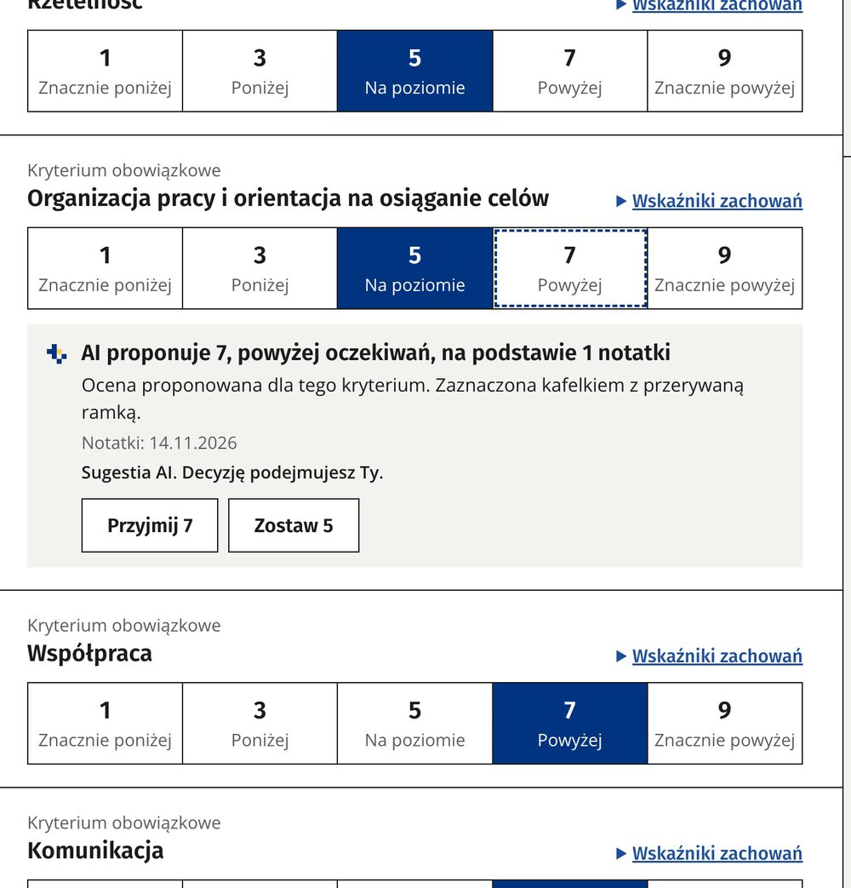
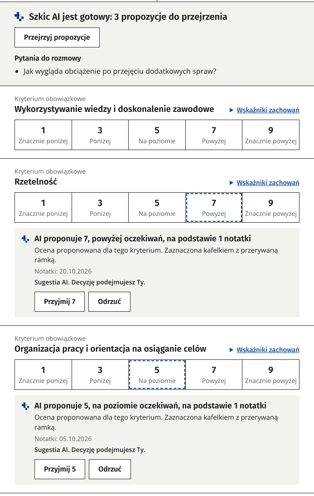
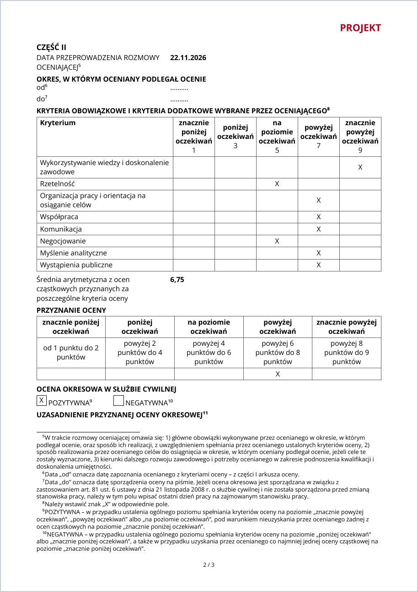
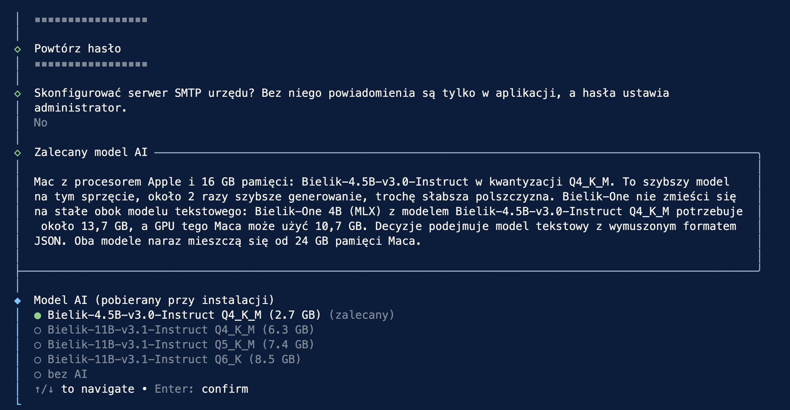

# Sarmata

**S**ystem **A**utomatycznej **R**ejestracji i **M**onitorowania **A**wansów, **T**erminów i **A**naliz

Sarmata prowadzi ocenę okresową w służbie cywilnej od wyboru arkusza do zamknięcia oceny: kryteria, rozmowy, notatki z okresu oceny, część II, sprzeciw, wniosek o stopień i PDF według wzoru z rozporządzenia. Terminy liczy z ustawy, a przepisy trzyma jako wersjonowane dane, więc nowelizacja to nowa wersja przepisów, a nie przebudowa systemu. Lokalny model Bielik podpowiada treść oceny, przygotowuje rozmowy i jako partner HR wskazuje przeciążenie oraz momenty na docenienie. Dane nie opuszczają serwera urzędu, a decyzje podejmuje przełożony.

## Dokumentacja

- [Prezentacja projektu (PDF)](docs/Sarmata_AGH_BIT_OMEGA.pdf): 15 slajdów o procesie oceny, arkuszach i PDF, terminach, lokalnym AI i partnerze HR, przepisach jako danych oraz wdrożeniu.
- [Instalacja w urzędzie](docs/instalacja.md): kreator, trzy profile (light, standard, server), aktualizacje i kopie zapasowe.
- [Uruchomienie i konfiguracja dla deweloperów](docs/dla-deweloperow.md): uruchomienie od czystej maszyny, `pnpm build` i `pnpm start`, skrypty, zmienne środowiskowe, konta demo.
- Dokumentacja techniczna: [architektura](docs/architektura.md), [decyzje architektoniczne (ADR)](docs/adr/), [funkcjonalności i reguły](docs/funkcjonalnosci.md), [wymagania i kontekst prawny](docs/wymagania-i-kontekst.md), [słownik pojęć](GLOSSARY.md).

## Wideo demonstracyjne

Kliknij miniaturę, aby obejrzeć prezentację Sarmaty na YouTube.

## Funkcje

### Pulpit z terminami z przepisów

Oceniający widzi sprawy na dziś, terminy wyliczone z ustawy i podpowiedzi partnera HR. Aplikacja przypomina o terminach i nie pozwoli zatwierdzić niepełnego arkusza.

### Szkic oceny od lokalnego Bielika

Przełożony może skorzystać ze szkicu oceny, który Bielik przygotuje na podstawie jego notatek. Każda propozycja poziomu wskazuje notatkę źródłową, a oceniający ją przyjmuje albo odrzuca. Wynik końcowy liczy kalkulator według progów z rozporządzenia, a nie model.

### Partner HR

Partner HR wychwytuje w notatkach oznaki przeciążenia i pokazuje fragment, na którym opiera sygnał. Podpowiada pytania do rozmowy wspierającej i działania, a przełożony może nie zgodzić się z sygnałem. To sugestia, a nie diagnoza, i nie trafia do arkusza.

### Arkusze A, B i C w PDF według wzoru

Aplikacja proponuje arkusz według stanowiska i prowadzi przez wszystkie jego pola. Gotową ocenę można pobrać jako PDF albo DOCX w układzie wzoru z rozporządzenia, a teczkę sprawy i paczkę do EZD jako pliki ZIP.

### Przepisy jako wersjonowane dane

Każdy termin, próg i kryterium ma podstawę prawną i należy do wersji przepisów. Administrator zmienia parametr w wersji urzędu i publikuje ją z datą wejścia w życie, a aktualizacja aplikacji przynosi nowe wersje po zmianie ustawy. Ocena zostaje przy wersji z dnia rozpoczęcia.

### Kreator instalacji

Kreator prowadzi krok po kroku przez instalację w jednym z trzech profili (light, standard, server) na Windows, macOS albo Linux, bez płatnych licencji. Sam dobiera model Bielik do sprzętu, a na mocniejszym sprzęcie uruchamia obok niego Bielik-One do sygnałów partnera HR.

## Możliwości rozwoju

1. **basal zamiast Bielik-One w sygnałach partnera HR.** [basal](https://huggingface.co/Remek) to rodzina modeli decyzyjnych w stylu Jev, tak jak Bielik-One. Model nie pisze tekstu, tylko zwraca skalibrowane prawdopodobieństwo każdej dozwolonej odpowiedzi w jednym przebiegu. W rankingu [Werdykt v1](https://basal.si5.pl/benchmark/) (5000 ukrytych decyzji po polsku i angielsku) [basal-omni-2.0-mini](https://huggingface.co/Remek/basal-omni-2.0-mini-preview) na Gemmie 4 E4B osiąga 0,811, a Bielik-One 11B 0,703 i Bielik-One 4B 0,696. Model mniejszy od Bielik-One 11B wypada więc lepiej od obu wariantów Bielik-One. Serwer basal przyjmuje zapytania w tym samym formacie `/v1/systemone`, którego Sarmata używa dziś, więc zmiana dotyczy głównie kreatora instalacji. Do sprawdzenia przed wdrożeniem: to wersja preview, w bfloat16 zajmuje około 20 GB pamięci karty, a jej wersje GGUF i MLX autor opisuje jako eksperymentalne.
2. **Mocniejszy model tekstowy zamiast Bielika.** Aplikacja rozmawia z modelem przez API zgodne z OpenAI, a llama.cpp uruchamia dowolny model GGUF, więc wymiana to zmiana listy modeli w kreatorze i sprawdzenie promptów na polskich danych. Kandydaci według sprzętu:
   - słabszy komputer bez karty graficznej: [LFM3-1.7B](https://huggingface.co/LiquidAI/LFM3-1.7B) albo [LFM2.5-8B-A1B](https://huggingface.co/LiquidAI/LFM2.5-8B-A1B-GGUF) od [LiquidAI](https://huggingface.co/LiquidAI), modele projektowane do pracy na urządzeniu
   - Mac z 16 GB i laptopy: [Gemma 4 E4B](https://huggingface.co/google/gemma-4-E4B-it) w kwantyzacji QAT od Google
   - serwer urzędu: [Gemma 4 26B-A4B](https://huggingface.co/google/gemma-4-26B-A4B-it), model MoE z 4 mld aktywnych parametrów, albo [Gemma 4 12B](https://huggingface.co/google/gemma-4-12B-it)
   - polski model rozwijany dla administracji: [PLLuM](https://huggingface.co/CYFRAGOVPL) 4B i 12B, do porównania z Bielikiem na tych samych promptach
