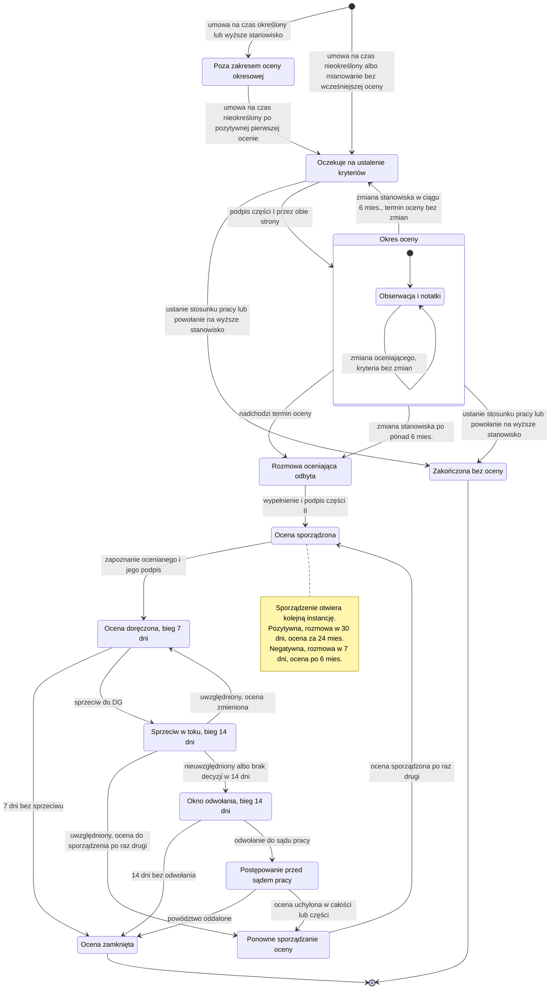
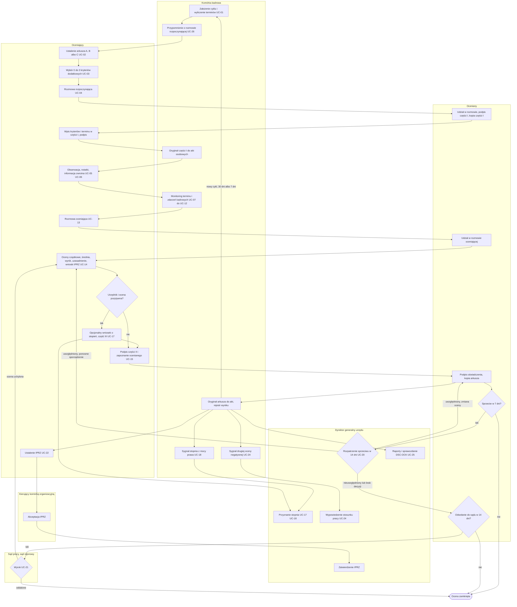

# Proces oceny okresowej i przypadki użycia (rekonstrukcja z przepisów)

Dokument zastępuje materiały „Przypadki użycia” i „Schemat procesu”, które organizator zapowiedział w general-info (sekcja 7), a których nie otrzymaliśmy. Wszystko poniżej odtworzono z tekstów aktów prawnych i wyjaśnień Departamentu Służby Cywilnej KPRM dostępnych lokalnie w `docs/legal/text/`. Stan prawny: 21.11.2026.

## 0. Skróty, źródła i oznaczenia

| Skrót | Akt lub dokument | Plik |
|---|---|---|
| u.s.c. | ustawa z 21.11.2008 r. o służbie cywilnej, Dz.U. 2026 poz. 590 t.j. | `01-ustawa-o-sluzbie-cywilnej-tj-2026.txt` |
| rozp. | rozporządzenie PRM z 4.04.2016 r. w sprawie ocen okresowych, Dz.U. 2016 poz. 470 (z załącznikami: wykaz kryteriów, arkusze A, B, C) | `02-rozp-prm-oceny-okresowe-2016.txt` |
| rozp. PO | rozporządzenie PRM z 23.07.2015 r. w sprawie pierwszej oceny, Dz.U. 2015 poz. 1144 | `03-rozp-prm-pierwsza-ocena-2015.txt` |
| rozp. szkol. | rozporządzenie PRM z 24.06.2015 r. w sprawie szkoleń w SC | `04-rozp-prm-szkolenia-w-sc-2015.txt` |
| zarz. 70 | zarządzenie nr 70 PRM z 6.10.2011 r. (zasady SC i etyka), M.P. 2011 nr 93 poz. 953 | `06-zarz-70-prm-zasady-sc-i-etyki-2011.txt` |
| zarz. 1 | zarządzenie nr 1 PRM z 7.01.2011 r. (opisy i wartościowanie stanowisk) w brzmieniu zarządzenia nr 57 PRM z 24.07.2015 r. | `07-...`, `08-...` |
| zarz. 6 | zarządzenie nr 6 Szefa SC z 12.03.2020 r. (standardy ZZL) | `zarzadzenie-6-szefa-sc-2020-standardy-zzl.txt` |
| KP | Kodeks pracy, t.j. 2026 | `10-kodeks-pracy-tj-2026.txt` |
| Kc | Kodeks cywilny, art. 110 do 115 (tekstu nie ma w repozytorium, odesłanie za DSC FAQ 11) | brak |
| DSC FAQ n | wyjaśnienia DSC „Oceny pracownicze”, pytanie nr n (opinia, nie wiążąca wykładnia) | `gov-pl-sluzbacywilna-oceny-pracownicze.txt` |
| DSC IPRZ n | wyjaśnienia DSC „Indywidualny program rozwoju zawodowego”, pytanie nr n | `gov-pl-sluzbacywilna-iprz.txt` |
| poradnik IPRZ | KPRM, „IPRZ członka korpusu SC. Poradnik dobrej praktyki”, 2011 (metodyka zalecana, niewiążąca) | `kprm-dsc-iprz-poradnik-dobrej-praktyki-2011.txt` |
| DSC-OCK | formularz sprawozdania DG „Oceny pracownicze, kompetencje miękkie i WLB” z objaśnieniami, 2025 | `kprm-dsc-formularz-DSC-OCK-...`, `kprm-dsc-instrukcja-DSC-OCK-2025.txt` |
| BOSC | instrukcja „Baza Ocen w Służbie Cywilnej” KPRM 2015 (wcześniejsze narzędzie KPRM) | `kprm-dsc-bosc-baza-ocen-w-sc-instrukcja-2015.txt` |
| SN | uchwały i wyroki Sądu Najwyższego: II PZP 2/14, III PZP 10/15, II PK 223/14, III PK 85/14 | `sn-*.txt` |
| DG | dyrektor generalny urzędu, a w urzędzie bez tego stanowiska kierownik urzędu (art. 25 ust. 9 u.s.c.) | |

Oznaczenia pewności przy twierdzeniach i w tabelach:

- **[P]** przepis rozstrzyga wprost,
- **[O]** rozstrzyga opinia DSC albo orzecznictwo SN (nie jest to przepis, ale wskazuje praktykę),
- **[N]** niejasne, do potwierdzenia z mentorami,
- **[Z]** założenie projektowe zespołu, nie wynika z przepisów.

Zakres podmiotowy w skrócie. Ocenie okresowej podlega urzędnik SC oraz pracownik SC na umowie na czas nieokreślony [P] (art. 81 ust. 1 u.s.c.). Nie podlegają jej osoby na wyższych stanowiskach w SC ani pracownicy na czas określony [O] (DSC FAQ 6). Osoba na wyższym stanowisku jest zatrudniona na podstawie powołania (art. 53a ust. 5 u.s.c.), a jej dotychczasowy stosunek pracy jest zawieszony urlopem bezpłatnym (art. 53a ust. 6 u.s.c.).

## 1. Model stanów cyklu oceny

### 1.1. Założenia modelu

1. Model opisuje jedną **instancję oceny** (jeden arkusz A, B albo C od części I do części II) [Z].
2. Sporządzenie oceny na piśmie otwiera od razu kolejną instancję, bo termin rozmowy rozpoczynającej biegnie od dnia sporządzenia poprzedniej oceny, a nie od jej uprawomocnienia (§ 7 rozp.) [P]. Ścieżka sprzeciwu i sądu toczy się więc równolegle z nowym cyklem [Z, wniosek z § 7 i art. 83 u.s.c.].
3. Procesy poboczne, które ocena uruchamia, mają własne modele: IPRZ (UC-22), stopień służbowy (UC-17, UC-18), rozwiązanie stosunku pracy (UC-24) [Z].
4. Nieobecność ocenianego nie wstrzymuje cyklu. Przedłuża tylko termin 24 miesięcy (art. 81 ust. 7 u.s.c.) [P]. Dlatego w modelu jest zdarzeniem wewnętrznym, a nie osobnym stanem [Z].

### 1.2. Diagram stanów

### 1.3. Stany

| Kod | Stan | Co oznacza | Podstawa |
|---|---|---|---|
| POZA | Poza zakresem | osoba jest członkiem korpusu, ale nie podlega ocenie okresowej | art. 81 ust. 1 u.s.c. [P], DSC FAQ 6 [O] |
| KRYT | Oczekuje na ustalenie kryteriów | instancja otwarta, biegnie termin na rozmowę rozpoczynającą i część I | § 5 do § 7 rozp. [P] |
| OKRES | Okres oceny | część I podpisana, oryginał w aktach osobowych, kopia części I u ocenianego. Data „od” okresu oceny = data zapoznania z kryteriami | § 6 rozp., przypis 5 do części II arkuszy [P] |
| ROZM | Rozmowa oceniająca odbyta | rozmowa z § 10 przeprowadzona, ocena jeszcze niesporządzona | § 10 rozp. [P] |
| SPORZ | Ocena sporządzona | część II (i ewentualnie III) wypełniona, podpis oceniającego. Data sporządzenia = data „do” okresu oceny | § 11 rozp., przypis 6 [P] |
| DOREC | Ocena doręczona | oceniany zapoznany z oceną i podpisał oświadczenie. Oryginał do akt, kopia dla ocenianego. Biegnie 7 dni na sprzeciw | § 12 rozp., art. 81 ust. 3, art. 83 ust. 1 u.s.c. [P] |
| SPRZ | Sprzeciw w toku | DG ma 14 dni od wniesienia | art. 83 ust. 3 u.s.c. [P] |
| PONOW | Ponowne sporządzanie | sprzeciw uwzględniony przez sporządzenie oceny po raz drugi albo sąd uchylił ocenę | art. 83 ust. 4 u.s.c. [P], SN III PZP 10/15 pkt 2 [O] |
| OKNO | Okno odwołania | oceniany ma 14 dni na odwołanie do sądu pracy | art. 83 ust. 5 u.s.c. [P] |
| SAD | Postępowanie sądowe | sąd rejonowy, sprawa niemajątkowa | SN II PZP 2/14 [O], SN III PK 85/14 [O] |
| ZAMK | Zamknięta | brak dalszych środków w urzędzie lub w sądzie | [Z] nazwa robocza |
| BEZ | Zakończona bez oceny | instancja przerwana zdarzeniem kadrowym | [N], zob. P-11, P-12 |

### 1.4. Przejścia, zdarzenia, warunki i terminy

Wszystkie terminy w dniach liczy się w dniach kalendarzowych, a w miesiącach według kalendarza (zob. P-01).

| Nr | Z | Zdarzenie | Warunek | Do | Termin | Podstawa |
|---|---|---|---|---|---|---|
| T-01 | start | zatrudnienie na czas nieokreślony | osoba nie była dotąd oceniana | KRYT | rozmowa i część I w 30 dni od zatrudnienia na czas nieokreślony. Termin oceny: 24 mies. od tego dnia | § 7 pkt 1 rozp. [P], DSC FAQ 10 [O] |
| T-02 | POZA | pozytywna pierwsza ocena, DG zawiera umowę na czas nieokreślony | | KRYT | jak T-01 | art. 35 ust. 6, art. 38 ust. 3 pkt 1 u.s.c. [P] |
| T-03 | KRYT | rozmowa z § 5 ust. 1, wpis kryteriów dodatkowych i terminu, podpisy | kryteria dodatkowe 0 do 3 z wykazu | OKRES | w terminie z T-01, T-20 albo T-21 | § 5, § 6, § 7 rozp. [P] |
| T-04 | OKRES | notatka, obserwacja, bieżąca informacja zwrotna | | OKRES | brak | zarz. 6 cz. IV pkt 6 [P dla urzędu, standard], przypis 2 general-info |
| T-05 | OKRES | usprawiedliwiona nieobecność ocenianego dłuższa niż miesiąc | dotyczy tylko terminu 24 mies. | OKRES | termin oceny + czas nieobecności | art. 81 ust. 7 u.s.c. [P], DSC FAQ 2, 19 [O] |
| T-06 | OKRES | oceniający zmienia termin oceny | jedna z 4 przyczyn z art. 81 ust. 8 i od ostatniej oceny minęło ponad 6 mies. (przy pierwszej ocenie: okres oceny dłuższy niż 6 mies.) | OKRES | pisemne zawiadomienie niezwłocznie, kopia do arkusza | art. 81 ust. 8 u.s.c., § 8 rozp. [P] |
| T-07 | OKRES | zmiana osoby na stanowisku oceniającego | | OKRES | kryteria bez zmian. Możliwa zmiana terminu (T-06) | § 9 ust. 3 rozp., art. 81 ust. 8 pkt 1 u.s.c. [P] |
| T-08 | OKRES | zmiana stanowiska z istotną zmianą zakresu obowiązków | w ciągu 6 mies. od ustalenia kryteriów (pierwsza ocena) albo od ostatniej oceny | KRYT | ponowna rozmowa i część I w 30 dni od zmiany. Termin oceny bez zmian | § 9 ust. 1 rozp. [P] |
| T-09 | OKRES | zmiana stanowiska z istotną zmianą zakresu obowiązków | od ostatniej oceny minęło ponad 6 mies. (pierwsza ocena: okres oceny dłuższy niż 6 mies.) | ROZM | ocena nie wcześniej niż 7 dni przed zmianą i nie później niż 30 dni po zmianie. Data „do” = ostatni dzień na starym stanowisku, jeśli ocena po zmianie | art. 81 ust. 6 u.s.c., § 9 ust. 2 rozp., przypis 6 [P] |
| T-10 | OKRES | nadchodzi termin oceny z części I | | ROZM | rozmowa przed sporządzeniem oceny | art. 81 ust. 4, § 10 rozp. [P] |
| T-11 | ROZM | sporządzenie oceny na piśmie | wszystkie kryteria ocenione, wnioski IPRZ wpisane, uzasadnienie przy negatywnej | SPORZ | w terminie oceny | § 11 rozp., art. 81 ust. 5 u.s.c. [P] |
| T-12 | SPORZ | zapoznanie ocenianego z oceną | | DOREC | niezwłocznie | art. 81 ust. 3 u.s.c., § 12 ust. 1 rozp. [P] |
| T-13 | DOREC | upływ terminu bez sprzeciwu | | ZAMK | 7 dni od zapoznania | art. 83 ust. 1 u.s.c. [P] |
| T-14 | DOREC | wniesienie sprzeciwu do DG | | SPRZ | do 7 dni od zapoznania | art. 83 ust. 1 u.s.c. [P] |
| T-15 | SPRZ | DG uwzględnia sprzeciw i zmienia ocenę | | DOREC | 14 dni od wniesienia | art. 83 ust. 3 i 4 u.s.c. [P]. Czy od oceny zmienionej przysługuje nowy sprzeciw [N], zob. P-20 |
| T-16 | SPRZ | DG uwzględnia sprzeciw, ocena do sporządzenia po raz drugi | | PONOW | 14 dni na decyzję. Termin na sporządzenie po raz drugi brak [N] | art. 83 ust. 4 u.s.c. [P] |
| T-17 | PONOW | ocena sporządzona po raz drugi | | SPORZ | brak terminu w przepisach [N] | art. 83 ust. 4 zd. 2 u.s.c. [P]: od tej oceny znów przysługuje sprzeciw |
| T-18 | SPRZ | DG nie uwzględnia sprzeciwu albo nie rozpatrzy go w terminie | | OKNO | 14 dni od doręczenia decyzji albo od upływu 14 dni na rozpatrzenie | art. 83 ust. 5 u.s.c. [P] |
| T-19 | OKNO | odwołanie do sądu pracy | | SAD | 14 dni | art. 83 ust. 5 u.s.c. [P], art. 9 ust. 2 u.s.c. |
| T-19a | SAD | wyrok uchylający ocenę | | PONOW | zgodnie z wyrokiem | SN III PZP 10/15 pkt 2 [O] |
| T-19b | SAD | wyrok oddalający | | ZAMK | | |
| T-20 | SPORZ (pozytywna) | otwarcie kolejnej instancji | | KRYT (nowa) | rozmowa w 30 dni od sporządzenia. Termin oceny: 24 mies. od sporządzenia | § 7 pkt 1 rozp., art. 81 ust. 4 u.s.c. [P], DSC FAQ 10 [O] |
| T-21 | SPORZ (negatywna) | otwarcie kolejnej instancji | | KRYT (nowa) | rozmowa w 7 dni od sporządzenia. Ocena po upływie 6 mies. od zapoznania z oceną negatywną, niezwłocznie po tym dniu | § 7 pkt 2 rozp., art. 81 ust. 9 u.s.c. [P], DSC FAQ 16 [O] |
| T-22 | KRYT, OKRES | ustanie stosunku pracy, powołanie na wyższe stanowisko | | BEZ | | art. 81 ust. 1 u.s.c. [P] (brak podmiotu oceny). Czy sporządzać ocenę na koniec [N] |
| T-23 | DOREC (negatywna, urzędnik) | druga z kolei ocena negatywna nie została skutecznie zakwestionowana | brak szczególnej ochrony | proces UC-24 | wypowiedzenie z upływem 7 dni bez sprzeciwu albo po nieuwzględnieniu lub nierozpatrzeniu sprzeciwu. Okres wypowiedzenia 3 mies. | art. 71 ust. 1 pkt 1, ust. 5 u.s.c. [P], DSC FAQ 20, 21 [O] |
| T-24 | DOREC (pozytywna, urzędnik) | dwie kolejne pozytywne oceny na jednym z dwóch najwyższych poziomów od ostatniego stopnia | | proces UC-18 | stopień w 30 dni od zapoznania | art. 89 ust. 2 u.s.c. [P] |

### 1.5. Wzory terminów dla silnika reguł

| Termin | Wzór | Podstawa |
|---|---|---|
| Rozmowa rozpoczynająca, pierwszy cykl | data zatrudnienia na czas nieokreślony + 30 dni | § 7 pkt 1 rozp. [P] |
| Rozmowa rozpoczynająca, po ocenie pozytywnej | data sporządzenia poprzedniej oceny + 30 dni | § 7 pkt 1 rozp. [P] |
| Rozmowa rozpoczynająca, po ocenie negatywnej | data sporządzenia oceny negatywnej + 7 dni | § 7 pkt 2 rozp. [P] |
| Ponowna rozmowa po zmianie stanowiska w 6 mies. | data zmiany stanowiska + 30 dni | § 9 ust. 1 rozp. [P] |
| Termin oceny, cykl zwykły | data sporządzenia poprzedniej oceny (albo zatrudnienia na czas nieokreślony) + 24 mies. + suma okresów usprawiedliwionej nieobecności dłuższych niż miesiąc | art. 81 ust. 4 i 7 u.s.c. [P], DSC FAQ 10 [O]. Sumowanie krótszych nieobecności [N], zob. P-03 |
| Termin oceny po negatywnej | data zapoznania z oceną negatywną + 6 mies., ocena niezwłocznie po tym dniu, bez przedłużania o nieobecność | art. 81 ust. 9 u.s.c. [P], DSC FAQ 16, 19 [O] |
| Okno oceny przy zmianie stanowiska po ponad 6 mies. | od (data zmiany - 7 dni) do (data zmiany + 30 dni) | § 9 ust. 2 rozp. [P] |
| Sprzeciw | data zapoznania z oceną + 7 dni | art. 83 ust. 1 u.s.c. [P] |
| Rozpatrzenie sprzeciwu | data wniesienia + 14 dni | art. 83 ust. 3 u.s.c. [P] |
| Odwołanie do sądu | data doręczenia decyzji DG + 14 dni, albo dzień upływu terminu rozpatrzenia + 14 dni | art. 83 ust. 5 u.s.c. [P] |
| Stopień z mocy prawa | data zapoznania z oceną + 30 dni | art. 89 ust. 2 u.s.c. [P] |
| Wypowiedzenie po dwóch negatywnych | od dnia, w którym ocena stała się niewzruszalna w urzędzie (T-23), okres wypowiedzenia 3 mies. | art. 71 ust. 1 u.s.c. [P], DSC FAQ 21 [O] |

## 2. Proces krok po kroku z torami ról

Tory: komórka kadrowa, oceniający (bezpośredni przełożony), oceniany, kierujący komórką organizacyjną (tylko IPRZ), DG, sąd pracy. Numery kroków odsyłają do przypadków użycia z sekcji 3.

Uwagi do schematu:

- Krok K5 do K1 (nowy cykl) startuje od dnia sporządzenia oceny, a nie od jej zamknięcia (§ 7 rozp.) [P].
- Krok K7 do D4 dotyczy tylko urzędnika SC (art. 71 ust. 1 pkt 1 u.s.c.) [P] i czeka na wynik sprzeciwu, ale nie na wyrok sądu (DSC FAQ 21) [O].
- Ponowne sporządzenie oceny prowadzi do O7. Czy trzeba powtórzyć rozmowę oceniającą (O6), przepisy nie mówią [N].

## 3. Katalog przypadków użycia

Aktorzy: Oceniający (OC), Oceniany (ON), Komórka kadrowa (KD), Kierujący komórką organizacyjną (KK), Dyrektor generalny urzędu (DG), Sąd pracy (SP), System (SYS, asystent cyfrowy). Rola SYS w każdym przypadku jest wspierająca. Ocenę sporządza wyłącznie bezpośredni przełożony (art. 81 ust. 1 u.s.c., DSC FAQ 7) [P, O], a decyzja nie może opierać się wyłącznie na przetwarzaniu zautomatyzowanym (art. 22 RODO, zob. wymagania-i-kontekst sekcja 18) [P].

### UC-01. Założenie cyklu oceny

- **Aktor główny:** KD. Wspiera SYS.
- **Warunki wstępne:** osoba jest urzędnikiem SC albo pracownikiem SC na umowie na czas nieokreślony (art. 81 ust. 1 u.s.c.) [P]. Znany jest bezpośredni przełożony i aktualny opis stanowiska.
- **Wyzwalacze:** zatrudnienie na czas nieokreślony, sporządzenie poprzedniej oceny, sporządzenie oceny negatywnej, zmiana stanowiska w 6 mies. od ustalenia kryteriów lub ostatniej oceny.
- **Scenariusz główny:**
  1. KD wskazuje pracownika i zdarzenie wyzwalające.
  2. SYS sprawdza, czy osoba podlega ocenie (status, rodzaj umowy, czy nie zajmuje wyższego stanowiska).
  3. SYS ustala oceniającego z pola „stanowisko pracy bezpośrednio nadzorujące” opisu stanowiska (pkt 2.2 wzoru, zarz. 1 zał. nr 1) [Z].
  4. SYS wylicza termin rozmowy rozpoczynającej i termin oceny według sekcji 1.5.
  5. SYS proponuje arkusz (UC-02) i powiadamia oceniającego.
- **Scenariusze alternatywne:**
  - 2a. Osoba na czas określony: SYS odmawia założenia oceny okresowej i proponuje pierwszą ocenę (art. 37, 38 u.s.c.) [P].
  - 2b. Osoba na wyższym stanowisku: SYS odmawia (DSC FAQ 6) [O].
  - 4a. Wyzwalaczem jest ocena negatywna: termin rozmowy 7 dni, termin oceny 6 mies. od zapoznania (§ 7 pkt 2 rozp., art. 81 ust. 9 u.s.c.) [P].
  - 4b. Pracownik został mianowany w trakcie cyklu: cyklu nie zakłada się od nowa (DSC FAQ 14) [O], zob. UC-30.
- **Wynik:** instancja w stanie KRYT z terminami i przypisanym oceniającym.
- **Podstawa:** art. 81 ust. 1, 4, 9 u.s.c., § 7 rozp.

### UC-02. Ustalenie właściwego arkusza (A, B, C)

- **Aktor główny:** OC. Wspiera KD, SYS.
- **Warunki wstępne:** UC-01 zakończony.
- **Scenariusz główny:**
  1. SYS odczytuje z opisu stanowiska pole 5 „Liczba podległych pracowników” i informację, czy stanowisko jest stanowiskiem kierownika urzędu.
  2. SYS proponuje: A dla kierownika urzędu, który zajmuje stanowisko w SC, B dla stanowiska polegającego na bezpośrednim kierowaniu pracownikami, C dla pozostałych (§ 3 ust. 2 do 4 rozp.) [P].
  3. OC potwierdza wybór. SYS ładuje listę kryteriów obowiązkowych (§ 4 rozp.) [P].
- **Scenariusze alternatywne:**
  - 2a. Opis stanowiska wskazuje „koordynuje pracę”, a nie „kieruje”. Pole 5 wzoru łączy oba pojęcia („bezpośrednio kieruje lub koordynuje pracę”), a § 3 ust. 3 rozp. mówi tylko o kierowaniu. SYS żąda decyzji OC z uzasadnieniem [N], zob. P-24.
  - 2b. Arkusz A: oceniający jest spoza urzędu, adresat sprzeciwu w pouczeniu do wpisania ręcznie (wzór arkusza A) [P], zob. P-08.
- **Wynik:** wybrany arkusz, lista kryteriów obowiązkowych (A: 6, B: 5, C: 5).
- **Podstawa:** § 3, § 4 rozp., załączniki nr 2 do 4.

### UC-03. Wybór kryteriów dodatkowych

- **Aktor główny:** OC. Wspiera SYS.
- **Warunki wstępne:** UC-02 zakończony, opis stanowiska dostępny.
- **Scenariusz główny:**
  1. SYS pokazuje główne zadania z opisu stanowiska (pkt 6, w tym 3 zadania dominujące) i 14 kryteriów z załącznika nr 1 z opisami.
  2. SYS proponuje kryteria związane z zadaniami (mapowanie z sekcji 5) [Z].
  3. OC wybiera od 0 do 3 kryteriów, najistotniejszych ze względu na charakter obowiązków (§ 5 ust. 2 rozp.) [P], i wpisuje krótkie uzasadnienie powiązania z opisem stanowiska [Z, bo § 2 ust. 2 rozp. wymaga, by wybór był „uzasadniony”, ale nie wymaga pisemnego uzasadnienia].
- **Scenariusze alternatywne:**
  - 3a. OC nie wybiera żadnego kryterium. Dopuszczalne (DSC FAQ 23) [O].
  - 3b. OC próbuje wybrać 4. kryterium. SYS blokuje (§ 5 ust. 2 rozp.) [P].
  - 3c. OC wybiera kryterium, które jest już obowiązkowe dla arkusza. SYS ostrzega [N], zob. P-10.
- **Wynik:** lista kryteriów dodatkowych gotowa do wpisu w części I.
- **Podstawa:** § 2 ust. 2 i 3, § 5 ust. 2 rozp., załącznik nr 1.

### UC-04. Przygotowanie i przeprowadzenie rozmowy rozpoczynającej, podpisanie części I

- **Aktorzy:** OC (główny), ON, KD, SYS.
- **Warunki wstępne:** stan KRYT, termin z § 7 rozp. nie upłynął.
- **Scenariusz główny:**
  1. SYS przygotowuje agendę z czterech obowiązkowych punktów § 5 ust. 1 rozp.: główne obowiązki z opisu stanowiska, kryteria obowiązkowe i dodatkowe, oczekiwania OC co do sposobu spełniania kryteriów, cele (jeśli uzasadnione charakterem obowiązków) i sposób ich realizacji [P].
  2. SYS podpowiada przykładowe oczekiwania na bazie wskaźników kryteriów z załącznika nr 1 [Z].
  3. OC przeprowadza rozmowę. SYS zapisuje, które punkty agendy omówiono.
  4. OC wpisuje do części I kryteria dodatkowe i termin sporządzenia oceny (dd.mm.rrrr) (§ 5 ust. 3 rozp.) [P].
  5. OC i ON podpisują potwierdzenie przeprowadzenia rozmowy i zapoznania z kryteriami i terminem (§ 6 ust. 1 i 2 rozp., wzór części I) [P].
  6. KD włącza oryginał do akt osobowych niezwłocznie, OC doręcza ON kopię części I (§ 6 ust. 3 rozp.) [P].
- **Scenariusze alternatywne:**
  - 1a. Cele nie są uzasadnione charakterem obowiązków: punkt 4 agendy pomijany z adnotacją [P, § 5 ust. 1 pkt 4 „jeżeli”].
  - 3a. Termin z § 7 rozp. minął. SYS rejestruje uchybienie, ale nie blokuje. Naruszenie terminu nie powoduje nieważności oceny (DSC FAQ 3) [O], może być naruszeniem obowiązków OC (DSC FAQ 4) [O], a sąd bada zachowanie trybu (SN III PZP 10/15 pkt 1) [O].
  - 5a. ON odmawia podpisu. Przepisy nie regulują [N], zob. P-29.
  - 5b. Podpis elektroniczny zamiast odręcznego [N], zob. P-30.
- **Wynik:** stan OKRES, data „od” okresu oceny = data zapoznania z kryteriami.
- **Podstawa:** § 5 do § 7 rozp., wzór części I, przypis 5 do części II.

### UC-05. Notatki i obserwacje w okresie oceny

- **Aktor główny:** OC. Wspiera SYS.
- **Warunki wstępne:** stan OKRES.
- **Scenariusz główny:**
  1. OC dodaje notatkę z datą, faktem, powiązaniem z zadaniem z opisu stanowiska i z kryterium oceny.
  2. SYS przypisuje notatkę do instancji oceny i kryterium.
  3. Przed rozmową oceniającą SYS zestawia notatki według kryteriów (UC-13).
- **Scenariusze alternatywne:**
  - 1a. Notatka zawiera dane o zdrowiu. SYS ostrzega i nie przetwarza ich w module AI. Zgoda pracownika jest podstawą przetwarzania danych z art. 9 RODO tylko, gdy pracownik przekazał je z własnej inicjatywy (art. 22[1b] § 1 KP) [P].
  - 1b. Notatka dotyczy poglądów politycznych, wyznania lub innej cechy chronionej. SYS ostrzega (art. 18[3a] § 1, art. 94 pkt 2b KP, § 17 zarz. 70) [P].
  - 2a. Zmiana oceniającego: dostęp poprzedniego OC do notatek wygasa, przekazanie notatek nowemu OC [N], zob. UC-09.
- **Wynik:** baza obserwacji dla oceny.
- **Podstawa:** obowiązek stosowania obiektywnych i sprawiedliwych kryteriów oceny (art. 94 pkt 9 KP) [P]. Przepisy o ocenie nie przewidują notatek, to funkcja wspierająca [Z]. Notatki są danymi osobowymi ON z prawem dostępu (art. 15 RODO) [P].

### UC-06. Bieżąca informacja zwrotna

- **Aktorzy:** OC (główny), ON, SYS.
- **Warunki wstępne:** stan OKRES. W urzędzie DG określił system informacji zwrotnej (zarz. 6 cz. IV pkt 6 ppkt 1) [P].
- **Scenariusz główny:**
  1. OC rejestruje sytuację wymagającą informacji zwrotnej.
  2. SYS podpowiada strukturę: konkretna, odnosząca się do zachowań i faktów, dostosowana do odbiorcy (zarz. 6 cz. IV pkt 6 ppkt 4) [P].
  3. OC przekazuje informację. SYS zapisuje datę i powiązanie z kryterium.
- **Scenariusze alternatywne:**
  - 1a. Informacja cykliczna (np. kwartalna) zamiast bieżącej (zarz. 6 cz. IV pkt 6 ppkt 3 lit. b) [P].
- **Wynik:** historia informacji zwrotnych dostępna przy UC-13.
- **Podstawa:** zarz. 6 cz. IV pkt 6. Element nieobowiązkowy w procesie oceny, zalecany standard ZZL (general-info, przypis 2).

### UC-07. Zmiana stanowiska w ciągu 6 miesięcy (ponowne ustalenie kryteriów)

- **Aktorzy:** KD (zgłasza zdarzenie), OC (główny), ON, SYS.
- **Warunki wstępne:** stan OKRES. Zmiana stanowiska wiąże się z istotną zmianą zakresu obowiązków. Od ustalenia kryteriów oceny sporządzanej po raz pierwszy albo od sporządzenia ostatniej oceny minęło nie więcej niż 6 mies.
- **Scenariusz główny:**
  1. KD rejestruje zmianę stanowiska z datą i nowym opisem stanowiska.
  2. SYS porównuje zadania dominujące starego i nowego opisu i prosi OC o kwalifikację zmiany jako istotnej [Z].
  3. SYS otwiera ponownie stan KRYT z terminem 30 dni od zmiany stanowiska.
  4. OC powtarza UC-02, UC-03, UC-04 dla nowego stanowiska.
  5. Termin sporządzenia oceny pozostaje bez zmian (§ 9 ust. 1 rozp.) [P].
- **Scenariusze alternatywne:**
  - 2a. Zmiana nie jest istotna: brak akcji, zapis decyzji z uzasadnieniem [N, pojęcie „istotnej zmiany” niezdefiniowane], zob. P-26.
  - 2b. Powierzenie innej pracy na podstawie art. 42 § 4 KP nie jest zmianą stanowiska (DSC FAQ 18) [O].
  - 4a. Nowe stanowisko ma innego bezpośredniego przełożonego. Nowy OC przeprowadza czynności [Z, wniosek z art. 81 ust. 1].
- **Wynik:** nowa część I z nowymi kryteriami, stary termin oceny. Data „od” w części II [N], zob. P-31.
- **Podstawa:** § 9 ust. 1 rozp.

### UC-08. Zmiana stanowiska po upływie 6 miesięcy (ocena przy zmianie)

- **Aktorzy:** KD, OC (główny), ON, SYS.
- **Warunki wstępne:** stan OKRES. Zmiana stanowiska z istotną zmianą zakresu obowiązków. Od sporządzenia ostatniej oceny minęło ponad 6 mies., a przy osobie ocenianej po raz pierwszy okres podlegający ocenie jest dłuższy niż 6 mies.
- **Scenariusz główny:**
  1. KD rejestruje planowaną albo dokonaną zmianę stanowiska.
  2. SYS wylicza okno: od 7 dni przed zmianą do 30 dni po zmianie (§ 9 ust. 2 rozp.) [P].
  3. OC przeprowadza UC-13, UC-14, UC-15 w tym oknie.
  4. Jeśli ocena powstaje po zmianie, data „do” w części II = ostatni dzień pracy na poprzednim stanowisku (przypis 6 do części II) [P].
  5. Sporządzenie oceny otwiera nowy cykl dla nowego stanowiska (T-20 albo T-21).
- **Scenariusze alternatywne:**
  - 3a. Po zmianie stanowiska zmienia się też przełożony. Kto ocenia po zmianie, stary czy nowy przełożony [N], zob. P-05.
  - 3b. Okno upłynęło bez oceny. SYS rejestruje uchybienie (DSC FAQ 3, 4) [O].
- **Wynik:** ocena okresowa sporządzona z mocy art. 81 ust. 6 u.s.c., nowy cykl.
- **Podstawa:** art. 81 ust. 6 u.s.c., § 9 ust. 2 rozp., przypis 6.

### UC-09. Zmiana oceniającego

- **Aktorzy:** KD, dotychczasowy OC, nowy OC, ON, SYS.
- **Warunki wstępne:** stan OKRES. Zmienia się osoba na stanowisku oceniającego.
- **Scenariusz główny:**
  1. KD rejestruje zmianę przełożonego z datą.
  2. SYS przepisuje instancję na nowego OC. Kryteria pozostają bez zmian (§ 9 ust. 3 rozp.) [P].
  3. SYS proponuje dotychczasowemu OC sporządzenie notatki przekazania [Z].
  4. Nowy OC prowadzi dalej UC-05, UC-06, a w terminie UC-13 do UC-15.
- **Scenariusze alternatywne:**
  - 2a. Od ostatniej oceny minęło ponad 6 mies. Dotychczasowy albo nowy OC może zmienić termin oceny (art. 81 ust. 8 pkt 1 u.s.c.) [P], np. przyspieszyć ją tak, by ocenił ten, kto obserwował pracę [Z]. Pisemne zawiadomienie ON, kopia do arkusza (§ 8 rozp.) [P].
  - 3a. Przekazanie notatek nowemu OC. Przepisy nie regulują, ryzyko RODO (minimalizacja, art. 5 ust. 1 lit. c RODO) [N].
- **Wynik:** instancja przypisana do nowego OC, kryteria bez zmian.
- **Podstawa:** § 9 ust. 3 rozp., art. 81 ust. 8 pkt 1 u.s.c., § 8 rozp.

### UC-10. Długa nieobecność ocenianego (przedłużenie z mocy prawa)

- **Aktorzy:** KD (główny), SYS, OC (informowany).
- **Warunki wstępne:** stan OKRES, termin oceny wynika z art. 81 ust. 4 u.s.c. (cykl 24 mies.).
- **Scenariusz główny:**
  1. KD rejestruje usprawiedliwioną nieobecność z datami. Usprawiedliwiona jest m.in. choroba, urlop wypoczynkowy, szkoleniowy, bezpłatny, macierzyński, wychowawczy (DSC FAQ 2) [O].
  2. Po zakończeniu nieobecności dłuższej niż miesiąc SYS przesuwa termin oceny o czas nieobecności (art. 81 ust. 7 u.s.c.) [P].
  3. SYS informuje OC i ON o nowym terminie [Z]. Pisemne zawiadomienie z § 8 rozp. dotyczy tylko zmiany z art. 81 ust. 8, a nie przedłużenia z mocy prawa [P, brzmienie § 8].
- **Scenariusze alternatywne:**
  - 1a. Nieobecność trwa w dniu terminu oceny. SYS oznacza termin jako „wstrzymany do powrotu” i przelicza po powrocie [Z]. Nieobecność sama w sobie nie jest prawną przeszkodą dla czynności oceny, ale niektóre czynności wymagają udziału stron (DSC FAQ 13) [O].
  - 2a. Kilka krótszych nieobecności, łącznie ponad miesiąc [N], zob. P-03.
  - 2b. Instancja po ocenie negatywnej (termin 6 mies.). Przedłużenie nie ma zastosowania (DSC FAQ 19) [O].
- **Wynik:** zaktualizowany termin oceny.
- **Podstawa:** art. 81 ust. 7 u.s.c., DSC FAQ 2, 13, 19.

### UC-11. Zmiana terminu oceny z inicjatywy oceniającego (przewidywana nieobecność)

- **Aktorzy:** OC (główny), ON, KD, SYS.
- **Warunki wstępne:** stan OKRES. Od ostatniej oceny minęło ponad 6 mies. (przy pierwszej ocenie: okres oceny dłuższy niż 6 mies.).
- **Scenariusz główny:**
  1. OC wskazuje przyczynę: przewidywana dłuższa usprawiedliwiona nieobecność ON, która może uniemożliwić ocenę, albo OC, która może ją utrudnić (art. 81 ust. 8 pkt 2 i 3 u.s.c.) [P].
  2. SYS sprawdza warunek 6 mies. i blokuje zmianę, jeśli nie jest spełniony [P].
  3. OC ustala nowy termin. SYS generuje pisemne zawiadomienie dla ON (§ 8 rozp.) [P].
  4. KD dołącza kopię pisma do arkusza (§ 8 rozp.) [P].
- **Scenariusze alternatywne:**
  - 3a. Nowy termin wcześniejszy albo późniejszy. Przepis nie ogranicza kierunku ani długości przesunięcia [N], zob. P-25.
  - 1a. Instancja po ocenie negatywnej. Czy art. 81 ust. 8 stosuje się do terminu z art. 81 ust. 9 [N], zob. P-25.
- **Wynik:** nowy termin oceny, pismo w arkuszu.
- **Podstawa:** art. 81 ust. 8 u.s.c., § 8 rozp.

### UC-12. Wniosek ocenianego o zmianę terminu

- **Aktorzy:** ON (główny), OC, KD, SYS.
- **Warunki wstępne:** stan OKRES. Od ostatniej oceny minęło ponad 6 mies. (przy pierwszej ocenie: okres oceny dłuższy niż 6 mies.).
- **Scenariusz główny:**
  1. ON składa wniosek o zmianę terminu (art. 81 ust. 8 pkt 4 u.s.c.) [P].
  2. SYS rejestruje wniosek i sprawdza warunek 6 mies.
  3. OC rozpatruje wniosek. Zmiana jest uprawnieniem OC, nie obowiązkiem („może zmienić”) [P].
  4. Przy zmianie: UC-11 kroki 3 i 4.
- **Scenariusze alternatywne:**
  - 3a. OC odmawia. Przepisy nie przewidują formy odmowy ani środka odwoławczego [N]. SYS zapisuje decyzję [Z].
  - 2a. Warunek 6 mies. niespełniony: SYS informuje ON, że zmiana jest niedopuszczalna [P].
- **Wynik:** wniosek rozpatrzony, ewentualnie nowy termin.
- **Podstawa:** art. 81 ust. 8 pkt 4 u.s.c., § 8 rozp.

### UC-13. Przygotowanie i przeprowadzenie rozmowy oceniającej

- **Aktorzy:** OC (główny), ON, SYS.
- **Warunki wstępne:** stan OKRES, zbliża się termin oceny albo okno z UC-08.
- **Scenariusz główny:**
  1. SYS przypomina OC o terminie (UC-26).
  2. SYS przygotowuje agendę z trzech punktów § 10 rozp.: główne obowiązki w okresie oceny i sposób ich realizacji z uwzględnieniem kryteriów, realizacja celów (jeśli były), kierunki rozwoju i potrzeby w zakresie kwalifikacji i umiejętności [P].
  3. SYS zestawia notatki (UC-05) i informacje zwrotne (UC-06) według kryteriów [Z].
  4. OC przeprowadza rozmowę przed sporządzeniem oceny na piśmie [P]. SYS zapisuje datę rozmowy (pole „Data przeprowadzenia rozmowy oceniającej” w części II) [P] i wnioski.
- **Scenariusze alternatywne:**
  - 4a. ON nieobecny w dniu rozmowy (UC-10, DSC FAQ 13).
  - 4b. OC nieobecny krótko w dniu terminu: rozmowa i ocena niezwłocznie po powrocie, z adnotacją w arkuszu (DSC FAQ 17) [O].
  - 4c. Rozmowa się nie odbyła, ocena sporządzona. Ocena nie jest nieważna (DSC FAQ 3) [O], ale sąd może ją uchylić za naruszenie trybu mające wpływ na wynik (SN III PZP 10/15 pkt 1 i 3) [O]. SYS blokuje przejście do UC-14 bez daty rozmowy [Z].
- **Wynik:** stan ROZM, wnioski z rozmowy, które OC uwzględnia przy ocenie (§ 11 ust. 2 rozp.) [P].
- **Podstawa:** § 10, § 11 ust. 2 rozp.

### UC-14. Sporządzenie oceny na piśmie

- **Aktor główny:** OC. Wspiera SYS.
- **Warunki wstępne:** stan ROZM.
- **Scenariusz główny:**
  1. OC przyznaje każdemu kryterium (obowiązkowemu i dodatkowemu) jedną ocenę cząstkową: 1, 3, 5, 7 albo 9 pkt (§ 11 ust. 1 pkt 1 rozp.) [P].
  2. SYS wylicza średnią arytmetyczną i ogólny poziom według progów: do 2 ZPO, powyżej 2 do 4 PO, powyżej 4 do 6 NPO, powyżej 6 do 8 POW, powyżej 8 do 9 ZPOW (§ 11 ust. 1 pkt 2 rozp.) [P].
  3. SYS ustala wynik: pozytywna, gdy poziom ogólny NPO lub wyżej i brak oceny cząstkowej 1 pkt, negatywna w pozostałych przypadkach (§ 11 ust. 1 pkt 3 i 4 rozp.) [P].
  4. OC wpisuje wnioski do IPRZ: kierunki rozwoju, obszary wiedzy i umiejętności do doskonalenia, formy i metody (§ 11 ust. 1 pkt 5 rozp., art. 81 ust. 5 u.s.c., przypis 12) [P]. SYS blokuje zapis bez wniosków (DSC FAQ 15) [O].
  5. Przy ocenie negatywnej OC sporządza uzasadnienie (§ 11 ust. 3 rozp.) [P]. Przy pozytywnej może (§ 11 ust. 4 rozp.) [P]. DSC zaleca uzasadnienie wszystkich ocen cząstkowych (DSC FAQ 22) [O].
  6. Dla urzędnika SC OC wypełnia dane poprzedniej oceny okresowej: ocena, poziom, data sporządzenia (część II, przypisy 13 i 14) [P]. Dla pracownika SC zaznacza „NIE DOTYCZY” w pytaniu o wniosek o stopień [P].
  7. OC podpisuje część II (miejscowość, data, podpis) [P].
- **Scenariusze alternatywne:**
  - 3a. Średnia wysoka, ale jedna ocena 1 pkt: wynik negatywny. SYS wyświetla wyjaśnienie [P].
  - 3b. Średnia dokładnie 4,00 (np. arkusz B z jednym kryterium dodatkowym: 3, 3, 3, 5, 5, 5): poziom „poniżej oczekiwań”, ocena negatywna [P, „powyżej 4 punktów” dla NPO].
  - 5a. Uzasadnienie oceny negatywnej powinno odnosić się do negatywnych ocen cząstkowych z prawdziwymi faktami, bo te sąd kontroluje (SN III PZP 10/15 pkt 1) [O]. SYS wymaga powiązania uzasadnienia z notatkami [Z].
  - 6a. Ocena pozytywna urzędnika: UC-17.
- **Wynik:** stan SPORZ. Otwarcie nowej instancji (T-20 albo T-21).
- **Podstawa:** § 11 rozp., art. 81 ust. 3 i 5 u.s.c., wzór części II.

### UC-15. Zapoznanie z oceną i obieg arkusza

- **Aktorzy:** OC (główny), ON, KD, SYS.
- **Warunki wstępne:** stan SPORZ.
- **Scenariusz główny:**
  1. OC niezwłocznie zapoznaje ON z oceną (art. 81 ust. 3 u.s.c., § 12 ust. 1 rozp.) [P].
  2. ON podpisuje oświadczenie: „Przeprowadzono ze mną rozmowę oceniającą oraz zapoznałem(-łam) się z oceną okresową i wnioskami dotyczącymi indywidualnego programu rozwoju zawodowego.” [P, wzór części II].
  3. SYS rejestruje datę zapoznania. Od niej biegnie 7 dni na sprzeciw, 6 mies. przy ocenie negatywnej, 30 dni na stopień z art. 89 ust. 2 [P].
  4. KD włącza oryginał do akt osobowych, OC doręcza ON kopię arkusza (§ 12 ust. 2 rozp.) [P].
- **Scenariusze alternatywne:**
  - 2a. ON odmawia podpisu [N], zob. P-29.
  - 2b. ON nieobecny. Zapoznanie po powrocie, niezwłocznie [O, DSC FAQ 17 per analogiam].
- **Wynik:** stan DOREC.
- **Podstawa:** art. 81 ust. 3 u.s.c., § 12 rozp.

### UC-16. Ocena negatywna i ponowna ocena po 6 miesiącach

- **Aktorzy:** OC (główny), ON, KD, SYS.
- **Warunki wstępne:** UC-14 zakończony wynikiem negatywnym.
- **Scenariusz główny:**
  1. SYS otwiera nową instancję z terminem rozmowy rozpoczynającej 7 dni od sporządzenia oceny negatywnej (§ 7 pkt 2 rozp.) [P].
  2. OC przeprowadza UC-02 do UC-04 w tym terminie.
  3. SYS ustawia termin oceny na pierwszy dzień po upływie 6 mies. od zapoznania z oceną negatywną (art. 81 ust. 9 u.s.c., DSC FAQ 16) [P, O].
  4. SYS nie przedłuża tego terminu o nieobecności (DSC FAQ 19) [O].
  5. OC przeprowadza UC-13 do UC-15.
- **Scenariusze alternatywne:**
  - 5a. Druga z kolei ocena negatywna urzędnika SC: UC-24.
  - 5b. Ocena negatywna zostaje zmieniona na pozytywną po sprzeciwie albo uchylona przez sąd. Co z instancją otwartą w kroku 1 [N], zob. P-22.
  - 1a. Rozmowa w 7 dni koliduje z biegiem 7 dni na sprzeciw. Rozmowa odbywa się mimo sprzeciwu [Z, wniosek z § 7 pkt 2].
- **Wynik:** ponowna ocena po 6 mies.
- **Podstawa:** art. 81 ust. 9 u.s.c., § 7 pkt 2 rozp.

### UC-17. Wniosek o kolejny stopień służbowy (art. 89 ust. 1)

- **Aktorzy:** OC (główny), DG, KD, SYS.
- **Warunki wstępne:** ON jest urzędnikiem SC, ocena pozytywna.
- **Scenariusz główny:**
  1. SYS pokazuje opcję części III tylko dla urzędnika i tylko przy ocenie pozytywnej (§ 11 ust. 5 rozp., przypis 16) [P].
  2. OC wypełnia część III: dane urzędnika, rok mianowania, posiadany stopień, data jego przyznania, numer wnioskowanego stopnia, umotywowanie [P, wzór części III].
  3. OC zaznacza w części II „TAK” przy pytaniu o dołączenie wniosku [P].
  4. Wniosek trafia do DG [Z]. Ustawa nie wskazuje wprost organu przyznającego kolejny stopień. DG przyznaje stopień przy mianowaniu (art. 51 u.s.c.) i dokonuje czynności z zakresu prawa pracy (art. 25 ust. 4 pkt 2 u.s.c.) [P].
- **Scenariusze alternatywne:**
  - 1a. Pracownik SC: część III nie jest drukowana, zaznaczenie „NIE DOTYCZY” [P].
  - 2a. Urzędnik ma już IX stopień. Wniosek niemożliwy, bo stopni jest 9 (art. 86 ust. 1 u.s.c.) [P]. SYS blokuje.
  - 4a. DG nie przyznaje stopnia. Wniosek z art. 89 ust. 1 daje możliwość („może otrzymać”), a nie prawo [P]. Termin decyzji DG nie jest określony [N].
- **Wynik:** wniosek o stopień w arkuszu.
- **Podstawa:** art. 89 ust. 1 u.s.c., § 11 ust. 5 rozp., część III arkusza.

### UC-18. Kolejny stopień służbowy z mocy prawa (art. 89 ust. 2)

- **Aktorzy:** SYS (wykrywa), KD, DG.
- **Warunki wstępne:** urzędnik SC zapoznany z oceną okresową.
- **Scenariusz główny:**
  1. SYS sprawdza, czy od otrzymania ostatniego stopnia urzędnik uzyskał dwie kolejne, następujące po sobie oceny pozytywne na jednym z dwóch najwyższych poziomów (POW albo ZPOW) [P].
  2. Jeśli tak, SYS zakłada zadanie dla KD i DG z terminem 30 dni od zapoznania z oceną [P].
  3. DG przyznaje kolejny stopień na piśmie [Z, analogia do art. 51 ust. 2 u.s.c.].
- **Scenariusze alternatywne:**
  - 1a. Jedna ocena POW, druga ZPOW. Czy spełnia warunek „na jednym z dwóch najwyższych poziomów” [N], zob. P-18.
  - 1b. Między ocenami była ocena sporządzona po zmianie stanowiska (art. 81 ust. 6) albo po sprzeciwie. Liczy się jako ocena okresowa [N].
  - 1c. Druga ocena jest przedmiotem sprzeciwu. Termin 30 dni biegnie od zapoznania, sprzeciw go nie wstrzymuje wprost [N], zob. P-22.
  - 1d. Urzędnik ma IX stopień: brak skutku (art. 86 ust. 1 u.s.c.) [P].
- **Wynik:** nowy stopień i dodatek SC według mnożnika (rozporządzenie Dz.U. 2025 poz. 670) [P].
- **Podstawa:** art. 89 ust. 2, art. 86 u.s.c.

### UC-19. Wniesienie sprzeciwu

- **Aktorzy:** ON (główny), KD, SYS.
- **Warunki wstępne:** stan DOREC, nie upłynęło 7 dni od zapoznania.
- **Scenariusz główny:**
  1. ON składa sprzeciw do DG (art. 83 ust. 1 u.s.c.) [P]. Forma pisemna nie jest wymagana przepisem [N], SYS przyjmuje sprzeciw z datą wpływu [Z].
  2. SYS ustala adresata: DG, a w urzędzie bez tego stanowiska kierownika urzędu (przypis 17 arkuszy B i C, art. 25 ust. 9 u.s.c.) [P].
  3. SYS rejestruje datę wniesienia i termin rozpatrzenia 14 dni [P].
- **Scenariusze alternatywne:**
  - 1a. Sprzeciw po terminie. Przepisy nie regulują skutku ani przywrócenia terminu [N]. SYS oznacza sprzeciw jako spóźniony i przekazuje DG [Z].
  - 2a. Arkusz A: adresat wpisany w pouczeniu [P], kim ma być [N], zob. P-08.
  - 2b. OC jest jednocześnie DG [N], zob. P-06.
  - 1b. Sprzeciw od oceny pozytywnej (np. o wyższy poziom). Dopuszczalny, art. 83 ust. 1 nie ogranicza do ocen negatywnych [P].
- **Wynik:** stan SPRZ.
- **Podstawa:** art. 83 ust. 1 i 3 u.s.c.

### UC-20. Rozpatrzenie sprzeciwu (warianty)

- **Aktorzy:** DG (główny), OC, ON, KD, SYS.
- **Warunki wstępne:** stan SPRZ.
- **Scenariusz główny (wariant A, nieuwzględnienie):**
  1. SYS udostępnia DG arkusz, sprzeciw, notatki dotyczące spornych kryteriów [Z].
  2. DG nie uwzględnia sprzeciwu w 14 dni od wniesienia [P].
  3. Decyzja jest doręczana ON. Od doręczenia biegnie 14 dni na odwołanie do sądu pracy (art. 83 ust. 5 u.s.c.) [P].
- **Wariant B, uwzględnienie przez zmianę oceny:** DG uwzględnia sprzeciw i ocena zostaje zmieniona (art. 83 ust. 4 zd. 1 u.s.c.) [P]. Kto zmienia ocenę (DG czy OC) [N], zob. P-19. ON zapoznaje się ze zmienioną oceną (stan DOREC). Czy przysługuje nowy sprzeciw [N], zob. P-20.
- **Wariant C, uwzględnienie przez sporządzenie oceny po raz drugi:** ocena jest sporządzana po raz drugi (art. 83 ust. 4 zd. 1 u.s.c.) [P]. Od niej przysługuje sprzeciw na tych samych zasadach (art. 83 ust. 4 zd. 2 u.s.c.) [P]. Kto ją sporządza, w jakim terminie i czy z nową rozmową oceniającą [N], zob. P-19.
- **Wariant D, nierozpatrzenie w terminie:** po 14 dniach bez decyzji ON może w ciągu kolejnych 14 dni odwołać się do sądu pracy (art. 83 ust. 5 u.s.c.) [P]. Czy DG może jeszcze rozstrzygnąć po terminie [N], zob. P-21.
- **Wynik:** stan DOREC, PONOW albo OKNO.
- **Podstawa:** art. 83 ust. 3 do 5 u.s.c. Szef SC nie może nakazać uwzględnienia sprzeciwu ani unieważnić oceny (DSC FAQ 5) [O].

### UC-21. Odwołanie do sądu pracy i wykonanie wyroku

- **Aktorzy:** ON (główny), SP, DG, KD, OC.
- **Warunki wstępne:** stan OKNO, nie upłynęło 14 dni.
- **Scenariusz główny:**
  1. ON wnosi odwołanie do sądu pracy (art. 83 ust. 5, art. 9 ust. 2 u.s.c.) [P]. Właściwy jest sąd rejonowy (SN II PZP 2/14) [O]. Sprawa ma charakter niemajątkowy (SN III PK 85/14) [O].
  2. KD rejestruje sprawę i przygotowuje dokumentację (arkusz, pisma z § 8, notatki, sprzeciw i decyzję) [Z].
  3. Sąd kontroluje tryb oceny oraz uzasadnienie negatywnych ocen cząstkowych pod kątem prawdziwości faktów i obiektywności kryteriów (art. 94 pkt 9 KP) (SN III PZP 10/15 pkt 1) [O].
  4. Sąd oddala powództwo albo uchyla ocenę w całości lub części. Sąd nie zmienia oceny (SN III PZP 10/15 pkt 2, SN II PK 223/14) [O].
  5. Po uchyleniu pracodawca dokonuje oceny ponownie (stan PONOW) [O].
- **Scenariusze alternatywne:**
  - 3a. Uchylenie oceny negatywnej tylko przy naruszeniach mających istotny wpływ na wynik (SN III PZP 10/15 pkt 3) [O].
  - 3b. Odwołanie od oceny pozytywnej: uchylenie tylko w szczególnie uzasadnionych okolicznościach (SN II PK 223/14) [O].
- **Wynik:** ocena zamknięta albo ponownie sporządzana.
- **Podstawa:** art. 83 ust. 5, art. 9 ust. 2 u.s.c., orzecznictwo SN.

### UC-22. Ustalenie, akceptacja i zatwierdzenie IPRZ

- **Aktorzy:** OC (ustala), KK (akceptuje), DG (zatwierdza), ON, SYS.
- **Warunki wstępne:** członek korpusu SC, który nie zajmuje wyższego stanowiska (art. 108 ust. 1 u.s.c.) [P]. Zwykle po ocenie z wnioskami do IPRZ, ale IPRZ można ustalić także osobie jeszcze nieocenionej (DSC IPRZ 4) [O].
- **Scenariusz główny:**
  1. SYS przenosi wnioski z części II arkusza do projektu IPRZ.
  2. OC ustala IPRZ, biorąc pod uwagę w szczególności: wnioski z oceny, planowaną ścieżkę awansu stanowiskowego i finansowego, plany i możliwości rozwoju ON, potrzeby i możliwości urzędu (art. 108 ust. 1 u.s.c.) [P].
  3. KK akceptuje IPRZ (art. 108 ust. 2 u.s.c.) [P].
  4. DG zatwierdza IPRZ (art. 108 ust. 2 u.s.c.) [P].
  5. IPRZ staje się podstawą kierowania na szkolenia (art. 108 ust. 1 u.s.c.) [P], także na szkolenia centralne, powszechne i specjalistyczne zgodne z IPRZ (§ 13 rozp. szkol.) [P].
- **Scenariusze alternatywne:**
  - 1a. Urząd ma ponad 50 członków korpusu: DG określa zasady opracowywania i realizacji IPRZ i roczny plan szkoleń (zarz. 6 cz. VI pkt 2) [P]. SYS konfiguruje procedurę według zasad urzędu [Z].
  - 1b. Metodyka poradnika IPRZ: rozmowa rozwojowa, ustalenie i akceptacja w 30 dni od niej, zatwierdzenie w 30 dni od przekazania DG, podpis pracownika, co najmniej jedno spotkanie monitorujące (poradnik IPRZ, tabela etapów) [O, niewiążące według DSC IPRZ 3].
  - 3a. OC jest jednocześnie DG: DG ustala, akceptuje i zatwierdza (DSC IPRZ 5) [O].
  - 4a. DG zwraca IPRZ do poprawy (poradnik IPRZ, etap IV) [O].
- **Wynik:** zatwierdzony IPRZ.
- **Podstawa:** art. 108 u.s.c., zarz. 6 cz. VI pkt 2. Zarządzenia PRM z art. 108 ust. 3 nie wydano (DSC IPRZ 2) [O].

### UC-23. Przejście z pierwszej oceny do oceny okresowej

- **Aktorzy:** KK, DG, KD, OC, SYS.
- **Warunki wstępne:** pracownik na umowie z art. 35 ust. 3 u.s.c. otrzymał pozytywną pierwszą ocenę (§ 10 rozp. PO) [P].
- **Scenariusz główny:**
  1. KK wnioskuje do DG o zawarcie umowy na czas nieokreślony (art. 38 ust. 3 pkt 1 u.s.c.) [P]. Wniosek jest obowiązkowy (DSC FAQ 28) [O].
  2. DG decyduje o zawarciu umowy (art. 35 ust. 6 u.s.c.) [P].
  3. KD rejestruje datę zatrudnienia na czas nieokreślony. SYS uruchamia UC-01 z terminem 30 dni (§ 7 pkt 1 rozp.) [P] i terminem oceny 24 mies. od tej daty (DSC FAQ 10) [O].
  4. SYS przenosi wnioski dotyczące rozwoju zawodowego z arkusza pierwszej oceny (§ 10 ust. 6 rozp. PO) [P] do przygotowania UC-03 i UC-22 [Z].
- **Scenariusze alternatywne:**
  - 1a. Pierwsza ocena negatywna: KK wnioskuje o niezawieranie umowy na czas nieokreślony albo o rozwiązanie umowy na czas określony (art. 38 ust. 3 pkt 2 u.s.c.) [P]. Od pierwszej oceny nie ma sprzeciwu, pracownik może dochodzić roszczeń przed sądem pracy (DSC FAQ 31) [O].
  - 3a. Umowa na czas nieokreślony zawarta przed upływem 12 mies. (DSC FAQ 30) [O]: termin 30 dni liczy się od tej wcześniejszej daty [P, § 7 pkt 1].
  - 3b. Pierwsza ocena okresowa przy zmianie stanowiska albo zmianie terminu wymaga, by okres oceny był dłuższy niż 6 mies. (art. 81 ust. 6 zd. 2 i ust. 8 u.s.c.) [P].
- **Wynik:** pierwsza instancja oceny okresowej w stanie KRYT.
- **Podstawa:** art. 35 ust. 6, art. 37, 38 u.s.c., rozp. PO, § 7 pkt 1 rozp.
- **Uwaga:** elementy pierwszej oceny (rzetelność, wykorzystywanie wiedzy, organizacja pracy, komunikacja, współpraca, § 2 pkt 1 rozp. PO) pokrywają się z kryteriami obowiązkowymi arkusza C (§ 4 ust. 3 rozp.) [P]. Skala jest inna: 3, 5, 7 pkt (§ 9 ust. 1 rozp. PO) [P].

### UC-24. Rozwiązanie stosunku pracy z urzędnikiem po dwóch negatywnych ocenach

- **Aktorzy:** SYS (wykrywa), KD, DG (główny).
- **Warunki wstępne:** urzędnik SC otrzymał dwie następujące po sobie negatywne oceny okresowe (art. 71 ust. 1 pkt 1 u.s.c.) [P].
- **Scenariusz główny:**
  1. SYS wykrywa drugą z kolei ocenę negatywną urzędnika i oznacza sprawę dla KD.
  2. SYS czeka na moment właściwy do wypowiedzenia: upływ 7 dni bez sprzeciwu albo nieuwzględnienie sprzeciwu, albo upływ 14 dni na jego rozpatrzenie (DSC FAQ 21) [O].
  3. KD sprawdza szczególną ochronę przed wypowiedzeniem, np. wiek przedemerytalny (art. 39 KP) albo ciążę (art. 177 KP) (art. 71 ust. 5 u.s.c., DSC FAQ 20) [P, O].
  4. DG rozwiązuje stosunek pracy z zachowaniem 3-miesięcznego okresu wypowiedzenia (art. 71 ust. 1, art. 74 u.s.c.) [P].
  5. DG może zwolnić urzędnika z obowiązku świadczenia pracy w okresie wypowiedzenia z zachowaniem wynagrodzenia (art. 72 u.s.c.) [P].
- **Scenariusze alternatywne:**
  - 2a. Urzędnik odwołał się do sądu pracy od oceny. Brak podstaw do wstrzymania wypowiedzenia do wyroku (DSC FAQ 21) [O].
  - 3a. Urzędnik objęty ochroną: wypowiedzenie z art. 71 ust. 1 niedopuszczalne (DSC FAQ 20) [O]. Cykl ocen trwa dalej [Z].
  - 1a. ON jest pracownikiem SC (nie urzędnikiem). Art. 71 nie ma zastosowania. Dwie oceny negatywne mogą być przyczyną wypowiedzenia na zasadach KP (art. 9 ust. 1 u.s.c., art. 30 § 4, art. 45 KP) [N], zob. P-23.
  - 1b. Pierwsza z ocen została zmieniona po sprzeciwie lub uchylona przez sąd. Czy „następujące po sobie” liczy się według ocen ostatecznych [N].
- **Wynik:** wypowiedzenie stosunku pracy albo odnotowanie przeszkody.
- **Podstawa:** art. 71 ust. 1 pkt 1, ust. 5, art. 72, art. 74 u.s.c.

### UC-25. Raporty i statystyki dla DG

- **Aktorzy:** DG (główny), KD, SYS.
- **Warunki wstępne:** dane ocen w systemie, uprawnienia do danych zagregowanych (general-info sekcja 3).
- **Scenariusz główny:**
  1. DG wybiera raport i okres.
  2. SYS generuje zestawienia zgodne z pytaniami 4 do 17 działu 1 formularza DSC-OCK: liczba pracowników na czas nieokreślony i urzędników, liczba ocen według poziomów (ogółem i dla urzędników), oceny negatywne, drugie kolejne oceny negatywne, sprzeciwy uwzględnione, nieuwzględnione i nierozpatrzone, odwołania do sądu, wnioski z art. 89 ust. 1, stopnie przyznane z art. 89 ust. 1 i 2 [P, formularz DSC-OCK].
  3. SYS dodaje pytania 1 do 3 o pierwsze oceny [P, formularz DSC-OCK].
  4. DG eksportuje dane do sprawozdania składanego Szefowi SC do końca stycznia (art. 25 ust. 5 u.s.c.) [P].
- **Scenariusze alternatywne:**
  - 2a. Raporty operacyjne na wzór BOSC: lista osób podlegających ocenie, terminy zbliżających się ocen, sporządzone oceny, oceny negatywne, wnioski o stopień (BOSC, rozdział 6) [O].
  - 2b. Potrzeby szkoleniowe z wniosków IPRZ do informacji przekazywanej Szefowi SC do 31 stycznia (§ 16 rozp. szkol.) [P].
  - 2c. Terminowość ocen według komórek i oceniających [Z]. Rozkład ocen per komórka przy małych grupach może ujawniać dane osób, SYS ukrywa grupy poniżej progu [Z, minimalizacja z art. 5 ust. 1 lit. c RODO].
- **Wynik:** raport i dane do sprawozdania DSC-OCK.
- **Podstawa:** art. 25 ust. 5 u.s.c., formularz DSC-OCK 2025, § 16 rozp. szkol.

### UC-26. Monitorowanie terminów i przypomnienia

- **Aktorzy:** SYS (główny), KD, OC, ON.
- **Warunki wstępne:** instancje w stanach KRYT, OKRES, DOREC, SPRZ, OKNO.
- **Scenariusz główny:**
  1. SYS codziennie przelicza terminy z sekcji 1.5.
  2. SYS wysyła przypomnienia: OC przed terminem rozmowy rozpoczynającej i oceny, DG przed upływem 14 dni na sprzeciw, KD o terminie 30 dni z art. 89 ust. 2 [Z].
  3. SYS oznacza uchybienia terminów.
- **Scenariusze alternatywne:**
  - 1a. Termin przypada w sobotę lub dzień wolny (zob. P-02).
- **Wynik:** lista zadań i alertów.
- **Podstawa:** terminy z sekcji 1.4. Funkcja F-30 z wymagań [Z].

### UC-27. Korekta błędnie wpisanego terminu oceny

- **Aktorzy:** OC (główny), ON, KD.
- **Warunki wstępne:** stan OKRES, w części I wpisano błędny termin.
- **Scenariusz główny:**
  1. OC wpisuje do arkusza poprawny termin.
  2. ON potwierdza podpisem zapoznanie z terminem (DSC FAQ 12) [O].
  3. SYS zachowuje historię zmiany [Z, wymóg integralności z § 9 rozporządzenia MRPiPS o dokumentacji pracowniczej].
- **Wynik:** skorygowany termin.
- **Podstawa:** DSC FAQ 12, § 5 ust. 3, § 6 ust. 2 rozp. per analogiam.

### UC-28. Zastępstwo oceniającego przy jego nieobecności

- **Aktorzy:** KD, przełożony pośredni lub zastępca OC, ON.
- **Warunki wstępne:** OC jest nieobecny długo, co utrudnia ocenę.
- **Scenariusz główny:**
  1. KD rejestruje nieobecność OC.
  2. Jeśli od ostatniej oceny minęło ponad 6 mies., OC przed nieobecnością może zmienić termin (UC-11) [P].
  3. W przeciwnym razie ocenę przeprowadza przełożony pośredni albo osoba zastępująca OC, w miarę możliwości po zasięgnięciu opinii OC (DSC FAQ 13) [O].
- **Scenariusze alternatywne:**
  - 3a. Nieobecność OC krótka (np. 2 dni) w dniu terminu: ocena niezwłocznie po powrocie, adnotacja w arkuszu (DSC FAQ 17) [O].
- **Wynik:** ocena sporządzona przez osobę uprawnioną.
- **Podstawa:** art. 81 ust. 1 i 8 u.s.c., DSC FAQ 13, 17. Status prawny oceny sporządzonej przez zastępcę wobec wymogu „bezpośredniego przełożonego” [N].

### UC-29. Zakończenie cyklu bez oceny

- **Aktorzy:** KD (główny), SYS.
- **Warunki wstępne:** instancja w stanie KRYT albo OKRES.
- **Scenariusz główny:**
  1. KD rejestruje ustanie stosunku pracy albo powołanie na wyższe stanowisko (urlop bezpłatny z art. 53a ust. 6 u.s.c.) [P].
  2. SYS zamyka instancję w stanie BEZ i archiwizuje dokumentację w aktach (część B akt osobowych) [Z].
- **Scenariusze alternatywne:**
  - 1a. Powrót z urlopu bezpłatnego po wyższym stanowisku. DG wyznacza stanowisko (art. 53a ust. 9 u.s.c.) [P]. Od kiedy liczyć nowy cykl [N], zob. P-11.
  - 1b. Przeniesienie do innego urzędu [N], zob. P-05.
- **Wynik:** instancja zamknięta bez oceny.
- **Podstawa:** art. 81 ust. 1, art. 53a u.s.c.

### UC-30. Mianowanie pracownika SC w trakcie cyklu

- **Aktorzy:** KD (główny), SYS.
- **Warunki wstępne:** pracownik SC w stanie OKRES uzyskuje mianowanie.
- **Scenariusz główny:**
  1. KD rejestruje mianowanie i stopień przyznany przez DG w 7 dni od mianowania (art. 51 ust. 1 u.s.c.) [P].
  2. SYS nie zmienia instancji oceny (DSC FAQ 14) [O].
  3. SYS zmienia profil: od teraz arkusz wymaga danych poprzedniej oceny urzędnika, dostępna jest część III, a licznik z art. 89 ust. 2 startuje od daty stopnia [P, art. 89 ust. 2 „od otrzymania ostatniego stopnia”].
- **Scenariusze alternatywne:**
  - 1a. Mianowanie łączy się ze zmianą stanowiska z istotną zmianą obowiązków: UC-07 albo UC-08 (DSC FAQ 14) [O].
- **Wynik:** ta sama instancja, nowy status ocenianego.
- **Podstawa:** art. 51, art. 89 u.s.c., DSC FAQ 14.

## 4. Przypadki brzegowe i pułapki

Kolumna „Rozstrzyga” zawiera to, co wynika z przepisu albo z opinii. Kolumna „Niejasne” zawiera pytania otwarte. Kolumna „Propozycja” to rozwiązanie robocze zespołu [Z].

| Nr | Sytuacja | Rozstrzyga | Niejasne | Propozycja |
|---|---|---|---|---|
| P-01 | Liczenie terminów | Terminy liczy się według art. 110 i nast. Kc przez art. 9 ust. 1 u.s.c. i art. 300 KP (DSC FAQ 11) [O]. Terminy w dniach są kalendarzowe, w dniu zdarzenia nie wlicza się, termin w miesiącach kończy się w dniu odpowiadającym datą dniowi początkowemu (art. 111, 112 Kc, tekst poza repozytorium). Przykład: ocena 4.04.2016, kolejna 4.04.2018 (DSC FAQ 10) [O] | Brak tekstu Kc w repozytorium, reguły podane z odesłania DSC | Moduł kalendarza zgodny z art. 111 do 115 Kc, testy brzegowe (31 dzień miesiąca, luty, rok przestępny) |
| P-02 | Koniec terminu w sobotę lub święto | Art. 115 Kc przesuwa koniec terminu na następny dzień roboczy (odesłanie z DSC FAQ 11) [O] | Czy stosować do terminów czynności pracodawcy (30 dni, 7 dni z § 7) czy tylko do sprzeciwu i odwołania | Przesuwać dla czynności stron, oznaczać w UI |
| P-03 | Okres nieobecności | Urlop wypoczynkowy, choroba, urlopy macierzyński i wychowawczy są nieobecnością usprawiedliwioną (DSC FAQ 2) [O]. Przedłużenie dotyczy tylko terminu 24 mies., nie terminu 6 mies. po ocenie negatywnej (DSC FAQ 19) [O] | Art. 81 ust. 7 mówi o nieobecności „trwającej dłużej niż miesiąc”. Czy sumować kilka krótszych nieobecności. Projekt nowelizacji używa słowa „łącznie” (art. 81a ust. 11 projektu), co sugeruje, że obecny przepis dotyczy jednej ciągłej nieobecności | Liczyć tylko pojedyncze ciągłe nieobecności ponad miesiąc, parametr konfigurowalny |
| P-04 | „Dłużej niż miesiąc” a „30 dni” | Przepis używa miesiąca, nie 30 dni [P] | Brak | Porównywać kalendarzowo (art. 112 Kc) |
| P-05 | Przeniesienie do innego urzędu (art. 64 u.s.c.) | Akta osobowe z dokumentacją przechodzą do nowego urzędu (art. 75 u.s.c.) [P] | Czy przeniesienie jest „zmianą stanowiska” z art. 81 ust. 6. Kto ocenia: dotychczasowy przełożony przed przeniesieniem czy nowy po nim. Czy instancja trwa dalej w nowym urzędzie z tymi samymi kryteriami. Projekt nowelizacji wprost to reguluje (art. 81a ust. 10 pkt 3 projektu), obecne przepisy nie | Traktować jako zmianę stanowiska z art. 81 ust. 6 i § 9, decyzja kadr obu urzędów, eksport instancji do nowego urzędu |
| P-06 | Oceniający jest jednocześnie DG | Sprzeciw przysługuje do DG (art. 83 ust. 1 u.s.c.) [P]. Dla IPRZ DSC przyjmuje, że DG wtedy ustala, akceptuje i zatwierdza (DSC IPRZ 5) [O] | DG rozpatruje sprzeciw od własnej oceny. Brak przepisu o wyłączeniu | Ostrzeżenie o konflikcie ról, rejestr decyzji, pytanie do mentorów |
| P-07 | Brak DG w urzędzie | W urzędach bez stanowiska DG jego zadania wykonuje kierownik urzędu (art. 25 ust. 9 u.s.c.), a sprzeciw składa się do kierownika (przypis 17 arkuszy B i C) [P]. Przy nieobsadzonym stanowisku zadania pełni osoba zastępująca DG (art. 25 ust. 7 i 8 u.s.c.) [P] | Brak | Parametr urzędu „ma DG tak albo nie”, rola „osoba zastępująca DG” z datami |
| P-08 | Kierownik urzędu i arkusz A | Arkusz A służy do oceny kierownika urzędu, którego stanowisko jest stanowiskiem w SC (§ 3 ust. 2 rozp.) [P]. Pole „sprzeciw do:” jest puste do wpisania (wzór arkusza A) [P]. DG podlega kierownikowi urzędu (art. 25 ust. 3 u.s.c.) [P] | Kto jest adresatem sprzeciwu kierownika urzędu (DG mu podlega, więc nie może rozpatrywać). Kto jest bezpośrednim przełożonym (organ nadrzędny spoza urzędu). Których urzędów to dotyczy, skoro np. powiatowy lekarz weterynarii zajmuje wyższe stanowisko (art. 52 pkt 3a u.s.c.) i nie podlega ocenie | Pole adresata konfigurowane per urząd, lista urzędów od mentorów |
| P-09 | Pracownik na czas określony | Nie podlega ocenie okresowej (art. 81 ust. 1 u.s.c., DSC FAQ 6) [P, O]. Pierwszy raz zatrudniony podlega pierwszej ocenie (art. 37 ust. 1, art. 38 u.s.c.) [P]. Zatrudniony na zastępstwo może jej podlegać (art. 37 ust. 2 u.s.c.) [P] | Pracownik na czas określony, który nie jest zatrudniony po raz pierwszy i nie jest na zastępstwie, nie ma żadnej oceny | Status „poza zakresem” z powodem, bez blokady innych funkcji (notatki, informacja zwrotna) |
| P-10 | Kryterium obowiązkowe wybrane jako dodatkowe | Kryteria dodatkowe wybiera się z wykazu (§ 5 ust. 2 rozp.) [P]. Arkusz ma osobne listy obowiązkowych i dodatkowych [P] | Przepis nie zakazuje dublowania wprost. Dublowanie podwaja wagę kryterium w średniej | Blokada z komunikatem, do potwierdzenia z mentorami |
| P-11 | Wyższe stanowisko w SC | Osoby na wyższych stanowiskach nie podlegają ocenie (DSC FAQ 6) [O] ani IPRZ (art. 108 ust. 1 u.s.c.) [P] | Od kiedy liczyć cykl po powrocie z urlopu bezpłatnego (art. 53a ust. 9 u.s.c.). Czy stosować § 7 pkt 1 per analogiam do „zatrudnienia” | Nowy cykl od dnia objęcia stanowiska po powrocie, decyzja kadr |
| P-12 | Ustanie stosunku pracy w trakcie cyklu | Brak obowiązku oceny na koniec [P, brak przepisu]. Projekt nowelizacji przewiduje możliwość oceny przy rozwiązaniu stosunku pracy (art. 81a ust. 13 pkt 3 projektu) | Brak | Zamknięcie instancji bez oceny |
| P-13 | Powierzenie innej pracy do 3 mies. (art. 42 § 4 KP) | Nie jest zmianą stanowiska z art. 81 ust. 6 (DSC FAQ 18) [O] | Brak | Typ zdarzenia kadrowego bez skutku dla cyklu |
| P-14 | Naruszenie terminów lub trybu | Ocena nie jest nieważna z mocy prawa (DSC FAQ 3) [O]. Może być naruszeniem obowiązków OC (DSC FAQ 4) [O]. Sąd bada tryb i może uchylić ocenę negatywną, gdy naruszenie miało istotny wpływ na wynik (SN III PZP 10/15) [O] | Brak | Ostrzeżenia, nie twarde blokady, z wyjątkiem rozmowy oceniającej przed sporządzeniem |
| P-15 | Średnia na progu | Progi: ZPO od 1 do 2, PO powyżej 2 do 4, NPO powyżej 4 do 6, POW powyżej 6 do 8, ZPOW powyżej 8 do 9 (§ 11 ust. 1 pkt 2 rozp.) [P]. Średnia 4,00 to PO i ocena negatywna | Przepis nie mówi o zaokrąglaniu | Liczyć na ułamkach dokładnych, bez zaokrąglania przed porównaniem, wyświetlać 2 miejsca po przecinku |
| P-16 | Wysoka średnia i jedna ocena 1 pkt | Ocena negatywna (§ 11 ust. 1 pkt 3 i 4 rozp.) [P] | Brak | Komunikat wyjaśniający |
| P-17 | Ocena „na poziomie oczekiwań” a stopień z mocy prawa | Liczą się tylko dwa najwyższe poziomy (art. 89 ust. 2 u.s.c.) [P] | Brak | Licznik zeruje się przy ocenie NPO lub niższej |
| P-18 | „Na jednym z dwóch najwyższych poziomów” | Dwie kolejne oceny pozytywne od ostatniego stopnia (art. 89 ust. 2 u.s.c.) [P] | Czy obie oceny muszą być na tym samym poziomie, czy wystarczy, że każda jest POW albo ZPOW | Wariant szerszy (każda POW albo ZPOW) jako parametr, pytanie do mentorów |
| P-19 | Kto zmienia ocenę albo sporządza ją po raz drugi | Sprzeciw uwzględniony skutkuje zmianą albo ponownym sporządzeniem (art. 83 ust. 4 u.s.c.) [P]. Ocenę sporządza bezpośredni przełożony (art. 81 ust. 1 u.s.c.) [P] | Czy DG zmienia ocenę sam, czy poleca to OC. W jakim terminie sporządzić ocenę po raz drugi. Czy powtarzać rozmowę oceniającą | Decyzja DG wskazuje wykonawcę i termin, SYS wymaga obu pól |
| P-20 | Sprzeciw od oceny zmienionej | Sprzeciw przysługuje od oceny sporządzonej po raz drugi (art. 83 ust. 4 zd. 2 u.s.c.) [P] | Przepis milczy o ocenie zmienionej | Traktować zmianę jako nowe zapoznanie z prawem sprzeciwu, do potwierdzenia |
| P-21 | DG nie rozpatrzył sprzeciwu w 14 dni | ON może odwołać się do sądu w 14 dni od upływu terminu (art. 83 ust. 5 u.s.c.) [P] | Czy DG może rozstrzygnąć po terminie i jak to wpływa na bieg 14 dni do sądu | Rejestrować decyzję spóźnioną, nie przerywać biegu terminu |
| P-22 | Skutek sprzeciwu dla terminów zależnych | Terminy z § 7 liczą się od sporządzenia, z art. 81 ust. 9 i art. 89 ust. 2 od zapoznania [P]. Wypowiedzenie z art. 71 czeka na wynik sprzeciwu (DSC FAQ 21) [O] | Co z nowym cyklem, gdy ocena negatywna zmieni się po sprzeciwie na pozytywną (7 dni i 6 mies. czy 30 dni i 24 mies.). Czy termin 30 dni na stopień biegnie w czasie sprzeciwu | Przeliczać instancję następną po zmianie wyniku, z historią zmian |
| P-23 | Dwie negatywne oceny pracownika SC (umowa) | Art. 71 dotyczy tylko urzędnika [P]. W sprawach nieuregulowanych stosuje się KP (art. 9 ust. 1 u.s.c.) [P] | Czy dwie oceny negatywne są wystarczającą przyczyną wypowiedzenia umowy na czas nieokreślony (art. 30 § 4, art. 45 KP) | Sygnał dla kadr bez automatycznej ścieżki |
| P-24 | Kierowanie a koordynowanie (arkusz B czy C) | Arkusz B dla stanowiska, na którym praca polega na bezpośrednim kierowaniu pracownikami (§ 3 ust. 3 rozp.) [P]. Wzór opisu stanowiska łączy w pkt 5 „kieruje lub koordynuje” [P] | Czy koordynator bez podległości służbowej jest oceniany na arkuszu B | Arkusz B tylko przy podległości służbowej, koordynacja jako przesłanka do kryterium dodatkowego „zarządzanie ludźmi” nie jest możliwa, bo to kryterium obowiązkowe B. Do potwierdzenia |
| P-25 | Zakres zmiany terminu z art. 81 ust. 8 | 4 przyczyny i warunek 6 mies. [P] | Czy można termin przesunąć dowolnie daleko. Czy przepis dotyczy terminu ponownej oceny po negatywnej (ust. 8 odsyła tylko do ust. 4) | Dopuszczać zmianę tylko dla terminu z ust. 4, wymagać uzasadnienia |
| P-26 | „Istotna zmiana zakresu obowiązków” | Warunek z art. 81 ust. 6 u.s.c. i § 9 rozp. [P] | Brak definicji | Heurystyka: zmiana co najmniej jednego zadania dominującego z opisu stanowiska. Zmiana zadań pobocznych nie wymaga ponownego wartościowania (§ 30 ust. 3 zarz. 1) [P], co wspiera tę heurystykę. Decyzja zawsze OC i kadr |
| P-27 | Brak lub nieaktualny opis stanowiska | Opis sporządza się dla każdego stanowiska, nowego niezwłocznie, aktualizuje niezwłocznie po zmianach zakresu (§ 1 ust. 1, § 2 ust. 1 i 2 zarz. 1) [P]. Pracodawca odpowiada za zapoznanie pracownika z opisem (§ 11 ust. 7 zarz. 1) [P] | Wpływ braku opisu na ważność oceny był przedmiotem pytania w sprawie SN III PZP 10/15, uchwała ogranicza uchylenie do naruszeń z istotnym wpływem na wynik [O] | Blokada UC-04 bez zatwierdzonego opisu z podpisem zapoznania, możliwość obejścia przez kadry z adnotacją |
| P-28 | Nieobecność OC w dniu terminu | Krótka: ocena niezwłocznie po powrocie z adnotacją (DSC FAQ 17) [O]. Długa: przełożony pośredni lub zastępca (DSC FAQ 13) [O] | Zgodność oceny przez zastępcę z art. 81 ust. 1 („bezpośredni przełożony”) | Rola „zastępca oceniającego” z okresem obowiązywania |
| P-29 | Odmowa podpisu przez ON | Wzory wymagają podpisu ON w części I i II [P] | Skutek odmowy. Brak przepisu o adnotacji czy świadkach | Adnotacja OC o odmowie z datą i obecnymi osobami, do potwierdzenia |
| P-30 | Podpis elektroniczny | Rozporządzenie wymaga „podpisu” bez określenia formy [P]. Dokumentacja elektroniczna jest równoważna papierowej (art. 94[11] KP) [P] | Jaki rodzaj podpisu (zatwierdzenie w systemie, podpis zaufany, osobisty, kwalifikowany) | Tryb hybrydowy: podpis elektroniczny konfigurowany per urząd, wydruk do podpisu odręcznego |
| P-31 | Data „od” po ponownym ustaleniu kryteriów (§ 9 ust. 1) | Data „od” = data zapoznania z kryteriami z części I (przypis 5) [P] | Która część I: pierwotna czy ponowna | Wpisywać datę pierwotną, ponowną część I przechowywać jako aneks |
| P-32 | Mianowanie w trakcie cyklu | Bez wpływu na ocenę (DSC FAQ 14) [O] | Brak | UC-30 |
| P-33 | Urzędnik z IX stopniem | Stopni jest 9 (art. 86 ust. 1 u.s.c.) [P] | Brak | Blokada części III i reguły z art. 89 ust. 2 |
| P-34 | Ocena po raz pierwszy przy zmianie stanowiska lub terminu | Ocena z art. 81 ust. 6 i zmiana terminu z ust. 8 wymagają okresu oceny dłuższego niż 6 mies. [P] | Okres „podlegający ocenie” liczony od daty zapoznania z kryteriami czy od zatrudnienia na czas nieokreślony | Liczyć od daty „od” z części I (przypis 5) |
| P-35 | Wersje przepisów | Do ocen rozpoczętych przed wejściem w życie nowych przepisów stosowano przepisy dotychczasowe, jeśli oceniany zapoznał się z kryteriami wcześniej (§ 13 rozp.) [P]. Trwa projekt nowelizacji (UDER102) z cyklem 12 mies., oceną pracowników na czas określony i nowym katalogiem kompetencji (art. 81a, 81b projektu) | Data wejścia w życie i przepisy przejściowe nowelizacji | Każda instancja zapisuje wersję reguł z dnia podpisania części I |
| P-36 | Podległość między krewnymi | Nie może powstać podległość służbowa między małżonkami, krewnymi do 2. stopnia i in. (art. 79 u.s.c.) [P] | Brak | Walidacja przy przypisaniu OC, jeśli kadry mają dane |

## 5. Opis stanowiska pracy i jego powiązanie z oceną

### 5.1. Dlaczego opis stanowiska jest wejściem procesu

Ocena okresowa dotyczy wykonywania obowiązków wynikających z opisu zajmowanego stanowiska pracy (art. 81 ust. 3 u.s.c.) [P]. Opis jest przywołany w rozporządzeniu w czterech miejscach: wybór kryteriów dodatkowych (§ 2 ust. 2, § 5 ust. 2), agenda rozmowy rozpoczynającej (§ 5 ust. 1 pkt 1 i 4), ocena cząstkowa za spełnianie kryteriów przy głównych obowiązkach (§ 11 ust. 1 pkt 1) [P]. Pełna nazwa stanowiska z rozszerzeniem „do spraw” w arkuszach B i C ma pochodzić z opisu (przypis 2 części I) [P].

### 5.2. Zasady prowadzenia opisów

- Opis sporządza się dla każdego stanowiska w SC (§ 1 ust. 1 zarz. 1) [P]. Wskazuje zadania, wymagane kompetencje, kwalifikacje i zakres odpowiedzialności, łącznie „zakres stanowiska” (§ 1 ust. 2 zarz. 1) [P].
- Jeden opis może obejmować kilka stanowisk o tej samej nazwie i zakresie (§ 1 ust. 2a zarz. 1 dodany zarz. 57) [P].
- Opis nowego stanowiska sporządza się niezwłocznie, przy zmianach zakresu aktualizuje się niezwłocznie (§ 2 ust. 1 i 2 zarz. 1) [P]. Zmiana samej metryki (część I) nie wymaga aktualizacji opisu, dołącza się zaktualizowaną metrykę (§ 2 ust. 3 i 4 zarz. 1 dodane zarz. 57) [P].
- Projekt opisu przygotowuje kierujący komórką, weryfikuje komórka kadr lub osoba wyznaczona, zatwierdza reprezentujący pracodawcę lub osoba upoważniona. Reprezentujący pracodawcę odpowiada za zapoznanie pracownika z opisem (§ 11 ust. 4 do 7 zarz. 1 w brzmieniu zarz. 57) [P].
- Wzór dla stanowisk niebędących wyższymi to załącznik nr 1, dla wyższych załącznik nr 2 (§ 1 ust. 3 i 4 zarz. 1, wzory z zarz. 57) [P]. Osoby na wyższych stanowiskach nie podlegają ocenie okresowej (DSC FAQ 6) [O], więc dla asystenta liczy się załącznik nr 1.

### 5.3. Pola wzoru opisu (załącznik nr 1, stanowisko niebędące wyższym) i ich użycie w ocenie

Mapowanie pól na kryteria to propozycja zespołu [Z]. Obowiązek powiązania kryteriów dodatkowych z obowiązkami z opisu wynika z § 2 ust. 2 i § 5 ust. 2 rozp. [P].

| Pole opisu | Zawartość według wzoru i objaśnień | Użycie w ocenie | Podstawa użycia |
|---|---|---|---|
| 1.1 Nazwa urzędu | | pole „Nazwa urzędu” w części I | wzór części I [P] |
| 1.2 Nazwa komórki organizacyjnej | | „Komórka organizacyjna” ocenianego (B, C) | wzór części I B, C [P] |
| 1.3 Nazwa stanowiska | zgodna z rozporządzeniem o stanowiskach urzędniczych | „Stanowisko pracy” w części I | wzór części I [P] |
| 1.4 Stanowisko do spraw (opcjonalnie) | rozszerzenie funkcjonalne | pełna nazwa stanowiska w B i C | przypis 2 części I B, C [P] |
| 1.5 Symbol stanowiska | przypisany do stanowiska, nie osoby | klucz łączący ocenę z wersją opisu [Z] | objaśnienia ad 1.5 |
| 2.1 i 2.2 Stanowisko nadzorujące pośrednio i bezpośrednio | | ustalenie OC (bezpośredni) i zastępcy przy nieobecności (pośredni) | art. 81 ust. 1 u.s.c. [P], DSC FAQ 13 [O] |
| 3 Zapoznanie pracownika z opisem | imię, nazwisko, data, podpis | warunek wstępny UC-04 | § 11 ust. 7 zarz. 1 [P], P-27 |
| 4 Cel istnienia stanowiska | do 3 zdań | kontekst celów z § 5 ust. 1 pkt 4 rozp. | [Z] |
| 5 Liczba podległych pracowników | brak, do 4, 5 do 9, powyżej 9, podlegają osoby kierujące | wybór arkusza B albo C | § 3 ust. 3 i 4 rozp. [P], P-24 |
| 6 Główne zadania (do 8, pierwsze 3 dominujące) | czasownik, przedmiot, cel | agenda rozmów (§ 5 ust. 1 pkt 1, § 10 pkt 1), podstawa wyboru kryteriów dodatkowych, test „istotnej zmiany” przy zmianie stanowiska | § 5, § 10, § 11 ust. 1 pkt 1 rozp. [P], P-26 [Z] |
| 7 Upoważnienia i pełnomocnictwa | decyzje administracyjne, środki publiczne, kontrole, zobowiązania, pełnomocnictwo procesowe, inne | kandydat do kryterium „Podejmowanie decyzji i odpowiedzialność” (w C jako dodatkowe) | [Z] |
| 8 Złożoność i kreatywność | opis, pytania pomocnicze o interpretację przepisów, sytuacje bezprecedensowe | kandydaci: „Kreatywność”, „Myślenie analityczne” | [Z] |
| 9 Niezbędna samodzielność i inicjatywa | stopień ingerencji przełożonego | „Podejmowanie decyzji i odpowiedzialność”, kalibracja oczekiwań w § 5 ust. 1 pkt 3 | [Z] |
| 10 Horyzont czasowy planowania | do miesiąca, do kwartału, do roku, powyżej roku | „Organizacja pracy” (obowiązkowe), przy horyzoncie powyżej roku „Zarządzanie strategiczne” | [Z] |
| 11 Kontakty zewnętrzne | częstotliwość i przykłady spoza urzędu | „Orientacja na klienta/interesanta”, „Negocjowanie”, „Wystąpienia publiczne” | [Z] |
| 12 Czynniki utrudniające | m.in. permanentna obsługa klientów zewnętrznych, częste reprezentowanie urzędu, nietypowe godziny, zagrożenie korupcją | „Orientacja na klienta”, „Wystąpienia publiczne”, „Radzenie sobie w sytuacjach kryzysowych”. Także sygnały obciążenia dla modułu HR partnera | [Z] |
| 13 Wymagane kompetencje i doświadczenie | wykształcenie, przeszkolenie, uprawnienia, języki, inne kompetencje, wymagania niezbędne i dodatkowe | luki kompetencyjne do wniosków IPRZ (przypis 12 części II, art. 108 ust. 1 pkt 3 u.s.c.) | [P] dla IPRZ, mapowanie [Z] |
| Część III Podpisy | kierujący komórką, osoba zatwierdzająca | status „zatwierdzony” jako warunek użycia w ocenie | § 11 ust. 4 zarz. 1 [P] |

### 5.4. Model danych powiązania [Z]

- `OpisStanowiska` z wersjami (data zatwierdzenia, data obowiązywania, symbol stanowiska, lista zadań z flagą „dominujące”).
- `InstancjaOceny` wskazuje wersję opisu obowiązującą w dniu podpisania części I i każdą kolejną wersję z okresu oceny.
- Zmiana wersji opisu w trakcie cyklu generuje zdarzenie do kwalifikacji przez OC: brak skutku, UC-07 albo UC-08.
- Kryterium dodatkowe przechowuje odwołanie do zadań z opisu, które je uzasadniają.

## 6. Zasady służby cywilnej i etyki istotne dla treści ocen

Zasady pochodzą z zarz. 70 (wydanego na podstawie art. 15 u.s.c.) i z obowiązków z art. 76 do 78 u.s.c. Poniżej tylko te, które wpływają na treść oceny, notatek i podpowiedzi asystenta.

### 6.1. Obowiązki członka korpusu, które pokrywają się z kryteriami

| Obowiązek lub zasada | Treść | Powiązane kryterium z załącznika nr 1 | Podstawa |
|---|---|---|---|
| Rzetelne, bezstronne, sprawne i terminowe wykonywanie zadań | | Rzetelność, Organizacja pracy | art. 76 ust. 1 pkt 4 u.s.c. [P] |
| Rozwijanie wiedzy zawodowej | | Wykorzystywanie wiedzy i doskonalenie zawodowe | art. 76 ust. 1 pkt 6 u.s.c. [P] |
| Zasada profesjonalizmu | posiadanie wiedzy, podnoszenie kwalifikacji, dzielenie się doświadczeniem, gotowość do przyjęcia krytyki i naprawy błędów, efektywne zarządzanie zasobami kadrowymi i czasem | Wykorzystywanie wiedzy, Współpraca, Zarządzanie ludźmi | § 7 pkt 1, 6, 7, 9 zarz. 70 [P] |
| Zasada rzetelności | sumienne wykonywanie zadań, dotrzymywanie zobowiązań, twórcze podejmowanie zadań | Rzetelność, Kreatywność | § 19 zarz. 70 [P] |
| Zasada odpowiedzialności za działanie lub zaniechanie | gotowość do rozliczenia się z działań, sygnalizowanie rozbieżności prawa i interesu publicznego | Podejmowanie decyzji i odpowiedzialność | § 8 zarz. 70 [P] |
| Zasada godnego zachowania | poszanowanie godności podwładnych, kolegów i przełożonych, zapobieganie konfliktom | Współpraca, Komunikacja, Orientacja na klienta | § 14 zarz. 70 [P] |
| Zasada służby publicznej | nieuchylanie się od trudnych rozstrzygnięć | Podejmowanie decyzji, Radzenie sobie w sytuacjach kryzysowych | § 15 pkt 5 zarz. 70 [P] |
| Kierujący odpowiada za przestrzeganie zasad przez podległych | wydaje polecenia usunięcia uchybień | Zarządzanie ludźmi (arkusze A, B) | § 11 ust. 1 pkt 4 zarz. 70 [P] |

### 6.2. Zasady, które ograniczają treść oceny i działanie asystenta

| Zasada | Skutek dla oceny i asystenta | Podstawa |
|---|---|---|
| Obiektywne i sprawiedliwe kryteria oceny | oceny cząstkowe opierają się na faktach z okresu oceny. Sąd bada prawdziwość faktów w uzasadnieniu negatywnych ocen cząstkowych | art. 94 pkt 9 KP [P], SN III PZP 10/15 [O] |
| Równe traktowanie i zakaz dyskryminacji | asystent nie podpowiada treści odwołujących się do płci, wieku, niepełnosprawności, religii, przekonań politycznych, przynależności związkowej, orientacji, rodzaju umowy i wymiaru etatu | art. 18[3a] § 1, art. 94 pkt 2b KP [P] |
| Ochrona godności i dóbr osobistych, także w obszarze efektów pracy i jej oceny | język uzasadnienia rzeczowy, bez ocen osoby. Asystent sprawdza sformułowania oceniające charakter zamiast zachowań | art. 94 pkt 2c KP [P] |
| Neutralność polityczna | ocena nie dotyczy poglądów i aktywności politycznej poza zakazami ustawowymi | § 17 zarz. 70, art. 78 ust. 2 u.s.c. [P] |
| Bezstronność oceniającego | jednakowe traktowanie ocenianych, brak konfliktu interesów, ostrzeżenie przy P-06 i P-36 | § 18 zarz. 70, art. 79 u.s.c. [P] |
| Jawność i przejrzystość, wyczerpujące uzasadnianie rozstrzygnięć | uzasadnienie oceny jasne, ze wskazaniem powodów. Spójne z zaleceniem DSC uzasadniania każdej oceny cząstkowej | § 5 pkt 2 i 3 zarz. 70 [P], DSC FAQ 22 [O] |
| Lojalność wobec podwładnych | informacja zwrotna rzetelna i życzliwa, bez ukrywania problemów do dnia oceny | § 16 pkt 3 zarz. 70 [P], zarz. 6 cz. IV pkt 6 [P] |
| Dochowanie tajemnicy i poufność informacji o życiu osobistym | notatki bez danych o życiu prywatnym, dostęp tylko dla uprawnionych | § 6 i § 7 pkt 11 lit. b zarz. 70 [P], art. 22[1b] KP [P] |

## 7. Lista niejasności do mentorów

Zestawienie pytań z oznaczeniem [N]. Numery wskazują miejsce w dokumencie.

1. Kto jest adresatem sprzeciwu od oceny kierownika urzędu na arkuszu A i kto jest wtedy oceniającym. Których urzędów to dotyczy (P-08).
2. Jak postępować, gdy oceniający jest jednocześnie DG, który rozpatruje sprzeciw od własnej oceny (P-06).
3. Przeniesienie do innego urzędu w trakcie cyklu: czy to zmiana stanowiska z art. 81 ust. 6, kto ocenia, czy instancja przechodzi (P-05).
4. Czy kryterium obowiązkowe może być wybrane także jako dodatkowe (P-10).
5. Czy nieobecności krótsze niż miesiąc sumują się dla art. 81 ust. 7 (P-03).
6. Czy art. 81 ust. 8 (zmiana terminu) stosuje się do ponownej oceny po ocenie negatywnej. Czy przesunięcie terminu ma granicę (P-25).
7. Przy uwzględnieniu sprzeciwu: kto zmienia ocenę, kto i w jakim terminie sporządza ją po raz drugi, czy trzeba powtarzać rozmowę oceniającą (P-19).
8. Czy od oceny zmienionej (art. 83 ust. 4 zd. 1) przysługuje kolejny sprzeciw (P-20).
9. Czy DG może rozpatrzyć sprzeciw po upływie 14 dni i jaki to ma skutek (P-21).
10. Jak przeliczać kolejny cykl, gdy ocena negatywna zmieni się po sprzeciwie lub zostanie uchylona przez sąd (P-22).
11. Art. 89 ust. 2: czy obie oceny muszą być na tym samym poziomie (POW i POW albo ZPOW i ZPOW), czy wystarczy, że każda jest jednym z dwóch najwyższych. Czy liczą się oceny z art. 81 ust. 6 (P-18, UC-18).
12. Kto i w jakim terminie przyznaje stopień na wniosek z art. 89 ust. 1 (UC-17).
13. Czy dwie kolejne oceny negatywne pracownika SC (umowa) są uznawaną w praktyce przyczyną wypowiedzenia (P-23).
14. Czy przy liczeniu „dwukrotnej, następującej po sobie” oceny negatywnej z art. 71 bierze się oceny ostateczne po sprzeciwie (UC-24).
15. Czy koordynator bez podległości służbowej jest oceniany na arkuszu B (P-24).
16. Jakie kryterium „istotnej zmiany zakresu obowiązków” stosują urzędy. Czy zmiana zadania dominującego jest dobrą regułą (P-26).
17. Która data „od” obowiązuje po ponownym ustaleniu kryteriów z § 9 ust. 1 (P-31).
18. Od kiedy liczyć okres „podlegający ocenie” przy pierwszej ocenie okresowej dla art. 81 ust. 6 i 8 (P-34).
19. Od kiedy liczyć nowy cykl po powrocie z wyższego stanowiska (P-11).
20. Czy ocena sporządzona przez przełożonego pośredniego lub zastępcę jest zgodna z art. 81 ust. 1 (UC-28, P-28).
21. Jak dokumentować odmowę podpisu przez ocenianego (P-29).
22. Jaki rodzaj podpisu elektronicznego akceptują urzędy pod arkuszem (P-30).
23. Czy przesunięcie końca terminu na dzień roboczy (art. 115 Kc) stosować do terminów czynności oceniającego z § 7 i § 9 (P-02).
24. Czy notatki oceniającego mogą być przekazywane nowemu oceniającemu przy zmianie (UC-09).
25. Czy sprzeciw wymaga formy pisemnej i jaki jest skutek sprzeciwu złożonego po terminie (UC-19).
26. Czy wnioski z drugiej oceny negatywnej (art. 71) powinny być w systemie sygnałem dla kadr, czy kadry wolą prowadzić to poza systemem (UC-24).
