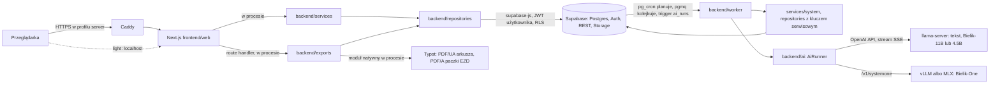

# Architektura: przegląd

Jedna strona o tym, z czego składa się system i jak go uruchamiamy. Uzasadnienia decyzji są w `docs/adr/`. Słownik pojęć domeny jest w `GLOSSARY.md`.

## Struktura repo

```
frontend/
  web/            Next.js (React, TS): strony, Server Components, server actions
  ui/             komponenty shadcn z CLI (nietknięte) i nasze nakładki
backend/
  domain/         typy, reguły prawne, strategie terminów, schematy zod (bez I/O)
  repositories/   jedyne miejsce z zapytaniami do bazy (supabase-js z JWT użytkownika, klucz serwisowy tylko w workerze)
  services/       logika, woła repositories, jedyne API dla frontend/web. Osobne wejście `@sarmata/services/system` (klucz serwisowy: powiadomienia, zamykanie ocen, retencja, synchronizacja przepisów) tylko dla workera i skryptów
  exports/        `@sarmata/exports`: eksport na żądanie (PDF/UA z Typst, DOCX, zawiadomienie o zmianie terminu, teczka sprawy ZIP, paczka EZD, archiwum teczek pracownika), route handler w frontend/web woła `exportsFor(db)`
  ai/             `@sarmata/ai`: `AiRunner` (zadania usług AI), klient API zgodnego z OpenAI ze streamingiem SSE, parser częściowego JSON, prompty w plikach (`prompts/<usługa>.v<n>.md`), wyszukiwarka tekstów prawnych (semble), klient decyzyjny Bielik-One. Woła go tylko worker
  worker/         proces Node: zadania z kolejki pgmq (typy w sekcji „Zadania w tle”), synchronizacja wersji przepisów przy starcie
  regulations/    oficjalne wersje przepisów: <wersja>/rules.json, strategie, przypadki testowe, teksty prawne do asystenta procedury (ADR 0006), katalog szkoleń (`development/training-catalog.json`)
database/         supabase: config.toml, migracje, seed, testy pgTAP, wygenerowane typy
infra/
  deploy/         kreator TUI (Bun, jeden plik), install.bat, install.sh, compose z profilami, Caddy
  ai-runtime/     `@sarmata/ai-runtime`: przypięte wersje llama.cpp, vLLM, MLX, pliki modeli Bielik z sumami SHA-256, wykrywanie sprzętu, rekomendacja tieru, skrypty `pnpm ai:*`
e2e/              Playwright
docs/             wymagania, prawo, research, ADR
```

## Procesy w czasie działania



- Supabase działa w kontenerach na Docker Engine (Linux natywnie, Windows przez WSL2). Kreator użyje też istniejącego silnika, np. Docker Desktop, jeśli urząd ma licencję. Można podłączyć zewnętrzną instancję Supabase przez zmienne środowiskowe.
- Worker działa w osobnym kontenerze w każdym profilu, także w light. Tylko on dostaje klucz serwisowy (ADR 0004).
- Runtime LLM działa natywnie, poza kontenerami, żeby miał dostęp do GPU. AI jest opcjonalne i domyślnie wyłączone w profilu light. Model woła wyłącznie worker (ADR 0008), aplikacja web tylko zapisuje przebieg `queued` i odczytuje go przez `ai.get`.
- Aplikację web kreator buduje lokalnie ze źródeł. Aktualizacja: kopia bazy, nowy build, migracje, restart, wycofanie przy błędzie.

## Zadania w tle

Kolejka to jedna kolejka pgmq `jobs` z typowanymi wiadomościami `{ type, payload }`. Worker czyta ją po jednym zadaniu, ponawia nieudane (do 5 dostarczeń co 60 s) i loguje JSON-em. Rejestr handlerów to `backend/worker/src/handlers/index.ts`, nowy typ zadania to nowy handler.

| Typ zadania | Kto wrzuca | Co robi worker |
|---|---|---|
| `notifications.send_digest` | `collect_notifications` (pg_cron `notifications-daily`, 5:00 UTC) | zbiorczy mail na konto i dzień przez SMTP urzędu albo instalatora, dziennik `notification_digests` |
| `evaluations.close_unobjected` | pg_cron `close-unobjected-daily`, 5:10 UTC | zamyka oceny `delivered` po upływie terminu sprzeciwu (`close_unobjected_evaluations`) |
| `retention.run` | pg_cron `retention-daily`, 5:30 UTC | retencja treści notatek i przebiegów AI, anonimizacja pracowników po 10 latach |
| `ai.run` | trigger na `ai_runs` po wstawieniu przebiegu `queued` | `claim`, wywołanie `AiRunner`, zapis postępu i wyniku (ADR 0008) |
| `system.ping` | ręcznie | zapis `pong` w logu, próba działania kolejki |

Zbieranie powiadomień jest funkcją SQL, więc `notifications-daily` nie przechodzi przez kolejkę, a jedynie wrzuca do niej zadania wysyłki. Dzień w zadaniach to data warszawska. Każde z trzech zadań cyklicznych da się też uruchomić ręcznie (`pnpm notifications:collect`, `pnpm retention:run`). Przy każdym starcie worker najpierw synchronizuje oficjalne wersje przepisów z `backend/regulations`.

## Profile instalacji

| Profil | Dla kogo | Supabase | AI | Sieć |
|---|---|---|---|---|
| light | jedno stanowisko, słaby sprzęt | minimalne (db, auth, rest, kong) | wyłączone | localhost |
| standard | mocniejsze stanowisko albo mały urząd | pełne | według tieru sprzętu | localhost albo LAN |
| server | urząd w sieci LAN | pełne, kopie zapasowe | tier sprzętu, najwyższa kwantyzacja 11B, która się mieści, Bielik-One na vLLM tylko przy karcie z 24 GB lub więcej | HTTPS przez Caddy |

## Tiery AI

Tier wybiera `recommendRuntime` w `infra/ai-runtime` (kreator i `pnpm ai:setup` tak samo, ADR 0005). Używamy tylko modeli Bielik.

| Sprzęt | Model tekstowy |
|---|---|
| Mac poniżej 24 GB albo karta od 8 do 11 GB | Bielik-4.5B-v3.0 Q4_K_M (tier szybki, domyślny) |
| Mac od 24 GB albo karta od 12 GB | Bielik-11B-v3.1 Q4_K_M (w profilu server najwyższa kwantyzacja, która się mieści) |
| bez karty graficznej, od 8 GB RAM | Bielik-4.5B-v3.0 Q8_0 |
| mniej niż 8 GB RAM | AI wyłączone |

Bielik-One (model decyzyjny dla sygnałów HR) instaluje się tylko tam, gdzie mieści się na stałe razem z modelem tekstowym: Mac od 32 GB i karta NVIDIA od 24 GB. Gdzie się nie mieści, decyzje podejmuje model tekstowy z wymuszonym schematem JSON. Trybu przełączanego nie ma, `--with-bielik-one` jest jawnym wyborem do testów. Progi i rachunek pamięci są w ADR 0005.

Odpowiedź modeli widać w trakcie: worker streamuje ją do `ai_runs` najwyżej raz na sekundę (`partial_text`, `partial_output`, `output_tokens`, szczegóły w ADR 0008). Szkic arkusza powstaje wywołaniami po jednym kryterium na wspólnym początku promptu (`cache_prompt`), więc pierwsze kryterium jest gotowe po kilkunastu sekundach na M2 z 16 GB.

## Narzędzia deweloperskie

- pnpm (Node 24) i Turborepo. Skrypty: `pnpm dev`, `build`, `test`, `lint`, `typecheck`, `check`, `db:*` (`start`, `stop`, `status`, `reset`, `seed:demo`, `types`, `test`), `regulations:sync`, `worker:*`, `notifications:collect`, `retention:run`, `ai:*` (`setup`, `env`, `start`, `stop`, `smoke`), `test:integration`, `e2e`, `secrets:decrypt`. Pełna lista jest w README.
- ESLint, Prettier, Husky (pre-commit: lint i format plików w stage, pre-push: typecheck i testy objęte zmianą).
- Vitest (domena, serwisy, eksport, AI, worker), testy integracyjne repozytoriów i workera na lokalnym Supabase (`pnpm test:integration`, poza CI), pgTAP (RLS i funkcje SQL), Playwright (e2e na kontach demo ról).
- CI w GitHub Actions: lint, typecheck i Vitest na PR. pgTAP i e2e na main i ręcznie.
- SOPS z kluczem age tylko dla sekretów zespołu i CI.
- Lokalne Supabase w dev: jedna wspólna instancja `sarmata` na portach 554xx dla wszystkich worktree. Typy: `supabase gen types`.
- Termic: skrypt setup (instalacja, sekrety, start Supabase) i skrypt run (`pnpm dev` na porcie unikalnym dla taska).

## Decyzje

| ADR | Temat |
|---|---|
| [0001](adr/0001-office-id-od-poczatku.md) | `office_id` w każdej tabeli od pierwszej migracji |
| [0002](adr/0002-uklad-repo-i-runtime.md) | układ repo, runtime'y, prace w tle, PDF (Typst jako moduł natywny) |
| [0003](adr/0003-wdrozenie-u-klienta.md) | wdrożenie, kreator, profile, Caddy, licencje |
| [0004](adr/0004-repozytoria-supabase-js.md) | warstwy backendu, pobieranie danych, minimum tożsamości |
| [0005](adr/0005-runtime-llm.md) | runtime LLM, tiery modeli Bielik (tier szybki 4.5B), próg pamięci dla Bielik-One |
| [0006](adr/0006-reguly-jako-wersjonowane-dane.md) | reguły prawne jako wersjonowane dane ze slotami strategii |
| [0007](adr/0007-podpis-jako-zatwierdzenie-w-systemie.md) | podpis arkusza jako zatwierdzenie w systemie przez oceniającego |
| [0008](adr/0008-ai-przez-kolejke.md) | wszystkie wywołania AI przez kolejkę pgmq i worker, `ai_runs` jako dziennik i stan, streaming postępu |

## Wątek funkcjonalny

Rozstrzygnięty w backendzie. Kto co widzi (widoczność ocen, notatki, wyniki AI), edytor reguł (serwis `regulationEditor` z grafem slotów), funkcje HR partnera (sygnały jako sugestia, zob. `AGENTS.md`) i reszta modelu opisuje `docs/funkcjonalnosci.md` wraz z listą rzeczy jeszcze nieimplementowanych. Do zrobienia zostaje frontend: ekrany, motyw gov, projekty w Pencil, branding służby cywilnej i interfejs edytora grafu reguł.
