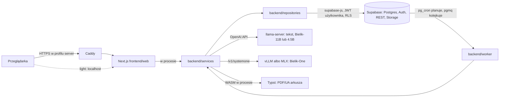

# Architektura: przegląd

Jedna strona o tym, z czego składa się system i jak go uruchamiamy. Uzasadnienia decyzji są w `docs/adr/`. Słownik pojęć domeny jest w `GLOSSARY.md`.

## Struktura repo

```
frontend/
  web/            Next.js (React, TS): strony, Server Components, server actions
  ui/             komponenty shadcn z CLI (nietknięte) i nasze nakładki
backend/
  domain/         typy, reguły prawne, strategie terminów, schematy zod (bez I/O)
  repositories/   jedyne miejsce z zapytaniami do bazy (supabase-js z JWT użytkownika)
  services/       logika, woła repositories, jedyne API dla frontend/web
  ai/             klient API zgodnego z OpenAI, prompty, endpoint decyzyjny Bielik-One
  worker/         proces Node: zadania z kolejki pgmq
  regulations/    oficjalne wersje przepisów: <wersja>/rules.json, strategie, testy (ADR 0006)
database/         supabase: config.toml, migracje, seed, testy pgTAP, wygenerowane typy
infra/
  deploy/         kreator TUI (Bun, jeden plik), install.bat, install.sh, compose z profilami, Caddy
  ai-runtime/     przypięte wersje llama.cpp, vLLM, MLX, tiery modeli Bielik, wykrywanie sprzętu
e2e/              Playwright
docs/             wymagania, prawo, research, ADR
```

## Procesy w czasie działania



- Supabase działa w kontenerach na Docker Engine (Linux natywnie, Windows przez WSL2). Kreator użyje też istniejącego silnika, np. Docker Desktop, jeśli urząd ma licencję. Można podłączyć zewnętrzną instancję Supabase przez zmienne środowiskowe.
- Runtime LLM działa natywnie, poza kontenerami, żeby miał dostęp do GPU. AI jest opcjonalne i domyślnie wyłączone w profilu light.
- Aplikację web kreator buduje lokalnie ze źródeł. Aktualizacja: kopia bazy, nowy build, migracje, restart, wycofanie przy błędzie.

## Profile instalacji

| Profil | Dla kogo | Supabase | AI | Sieć |
|---|---|---|---|---|
| light | jedno stanowisko, słaby sprzęt | minimalne (db, auth, rest, kong) | wyłączone | localhost |
| standard | mocniejsze stanowisko albo mały urząd | pełne | według tieru sprzętu | localhost albo LAN |
| server | urząd w sieci LAN | pełne, kopie zapasowe | tekst i Bielik-One na vLLM | HTTPS przez Caddy |

## Narzędzia deweloperskie

- pnpm (Node 24) i Turborepo. Skrypty `pnpm dev`, `build`, `test`, `lint`, `typecheck`, `db:*`, `e2e`, `secrets:decrypt`.
- ESLint, Prettier, Husky (pre-commit: lint i format plików w stage, pre-push: typecheck i testy objęte zmianą).
- Vitest (domena i serwisy), pgTAP (RLS i funkcje SQL), Playwright (e2e na kontach demo ról).
- CI w GitHub Actions: lint, typecheck i Vitest na PR. pgTAP i e2e na main i ręcznie.
- SOPS z kluczem age tylko dla sekretów zespołu i CI.
- Lokalne Supabase w dev: jedna wspólna instancja `sarmata` na portach 554xx dla wszystkich worktree. Typy: `supabase gen types`.
- Termic: skrypt setup (instalacja, sekrety, start Supabase) i skrypt run (`pnpm dev` na porcie unikalnym dla taska).

## Decyzje

| ADR | Temat |
|---|---|
| [0001](adr/0001-office-id-od-poczatku.md) | `office_id` w każdej tabeli od pierwszej migracji |
| [0002](adr/0002-uklad-repo-i-runtime.md) | układ repo, runtime'y, prace w tle, PDF |
| [0003](adr/0003-wdrozenie-u-klienta.md) | wdrożenie, kreator, profile, Caddy, licencje |
| [0004](adr/0004-repozytoria-supabase-js.md) | warstwy backendu, pobieranie danych, minimum tożsamości |
| [0005](adr/0005-runtime-llm.md) | runtime LLM i tiery modeli Bielik |
| [0006](adr/0006-reguly-jako-wersjonowane-dane.md) | reguły prawne jako wersjonowane dane ze slotami strategii |

## Odłożone do wątku funkcjonalnego

- Kto co widzi w ramach urzędu (otwarta historia ocen a role, notatki robocze).
- Edytor grafu reguł i zakres slotów strategii.
- Ekrany, motyw gov, projekty w Pencil, branding służby cywilnej.
- Funkcje HR partnera (analiza wypalenia jako sugestia, zob. `AGENTS.md`).
